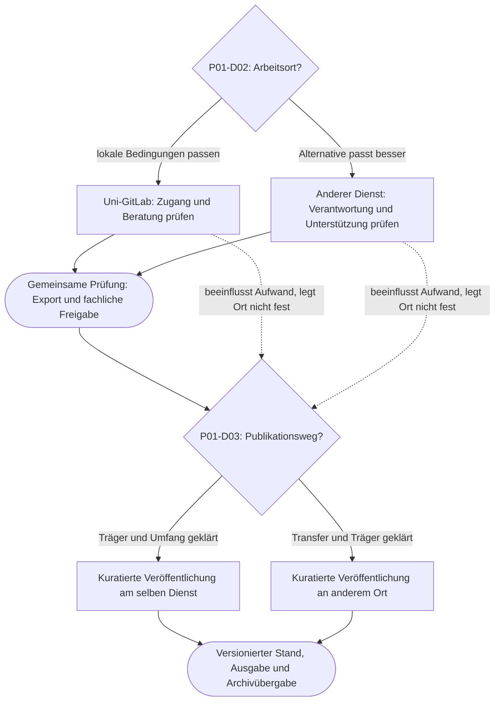

# Vier Git-Strategien digitaler Editionsprojekte

## 1. Zweck und Verbindlichkeit

Diese Grammatik ist die gemeinsame Bauanleitung für vier vergleichbare Fallstudien und ihre Materialien in Web, Druck und interaktiver Erkundung. Sie unterstützt Orientierung, Diskussion und begründete Entscheidungen: Welcher Umgang mit Git passt zu diesem Editionsprojekt, welche Möglichkeiten eröffnet er, welche Verpflichtungen entstehen und wie bleibt ein Wechsel möglich?

Das Ergebnis einer Erkundung ist ein **vorläufiges Strategieblatt mit Gründen, offenen Fragen, Zuständigkeiten und Revisionsanlass**. Die vier Prototypen sind wiedererkennbare Ausgangslagen, keine Rangfolge und keine abschließende Klassifikation. Ein Projekt kann Merkmale mehrerer Prototypen verbinden und im Verlauf seine Strategie ändern.

**MUSS** bezeichnet eine verbindliche Regel dieser Materialfamilie, **SOLL** einen Standard mit begründbaren Ausnahmen, **KANN** eine optionale Erweiterung. Diese Wörter formulieren redaktionelle Regeln, keine allgemeinen rechtlichen Pflichten.

### Herkunft und Grenzen

- **[G] Gesprächsbasis:** Nutzerbeiträge aus „Vorschläge für Minimalprojekt“, Gesprächs-ID `6ad702da-1838-83eb-bb3f-2882a82b158d`. Der Abruf enthielt die Nutzerbeiträge, die Assistenzantworten jedoch nur als Inhaltsplatzhalter. Deren genaue Vorschläge und die ursprünglichen vier Profile sind deshalb nicht rekonstruierbar.
- **[Q-S] Skript:** [skript.pdf](sources/skript.pdf), 28 PDF-Seiten.
- **[Q-F] Folien:** [folien.pdf](sources/folien.pdf), 52 PDF-Seiten. Titel: „Editionspraxis im digitalen Zeitalter: Repositorien als Zeugnisse editorischer Entscheidungsprozesse?“, Thomas Jäger, Universität Wien.
- **[M] Modellvorschlag:** Die folgende Grammatik, Skalen, vier Arbeitsprofile, Templates und ergänzten Details zu Anna sind redaktionelle Vorschläge. Die Figuren und Szenarien sind fiktiv. Sie wurden nicht empirisch validiert.
- **[A] Nachgereichte Arbeitsgrundlage:** „Arbeitsgrundlage für Work: Prototyp 1 – Anna, die Ein-Personen-Edition“, Stand 20. Oktober 2026, bereitgestellt als `anna_prototyp_arbeitsgrundlage.md`. Sie präzisiert den bisherigen Konzeptstand, ist nach eigener Statusangabe keine verabschiedete Spezifikation. Enthaltene Arbeitsaufträge werden als Dokumentinhalt behandelt; diese Überarbeitung folgt dem Auftrag im aktuellen Chat. Anna-Angaben aus [A] sind Modellannahmen, keine empirischen Personenangaben.

PDF-Seitenangaben zählen ab der ersten Dateiseite. Skript und Folien gehören zusammen; sie bilden keine zwei unabhängigen empirischen Belege. Die Auswertung ist inhaltlich; Diagrammdaten wurden nicht nachgerechnet. Anbieterbedingungen, Lizenzberechtigungen und konkrete Diensteigenschaften werden hier nicht als aktuell geprüft vorausgesetzt.

| Quellenmotiv | Fundstelle | Konsequenz für die Grammatik |
| --- | --- | --- |
| Arbeit und Publikation sind unterschiedliche Funktionen, auch wenn sie kombiniert werden | Q-S S. 1–2; Q-F S. 2–4 | Getrennte Inhaltsfelder und Entscheidungen |
| Versionierung, Sicherung und Zusammenarbeit erfüllen unterschiedliche Aufgaben | Q-S S. 3–7; Q-F S. 5–14 | Architektur statt bloßer Plattformwahl zeigen |
| Koordination und Rollen prägen den Arbeitsprozess | Q-S S. 11–14; Q-F S. 20–26 | Zuständigkeiten und Unterstützungsbedarf sichtbar machen |
| Git bildet nur Teile wissenschaftlicher Arbeit ab | Q-S S. 14–16; Q-F S. 26–29 | Keine Leistungsranglisten aus Commits |
| Fortschritt ist nicht linear; Prognosen sind modellabhängig | Q-S S. 17–21; Q-F S. 30–36 | Unsicherheit und Annahmen ausweisen |
| Interne Kommentare können in früheren Ständen erhalten bleiben | Q-S S. 22; Q-F S. 38 | Publikationsumfang einschließlich Historie prüfen |
| Transparenz erzeugt soziale und institutionelle Abwägungen | Q-S S. 23–28; Q-F S. 39–49 | Schutz, Unterstützung und Verantwortung gemeinsam behandeln |

Zugespitzte Aussagen der Materialien werden nicht als universelle Regeln übernommen: Commitzahlen messen weder Arbeitszeit noch wissenschaftliche Qualität; Aktivitätsrhythmen erlauben keine belastbare Diagnose persönlicher Lebensumstände. Git-Kopien ersetzen kein geprüftes Backup. Eine Plattformbezeichnung garantiert weder Sicherheit noch langfristigen Zugang. Branches innerhalb eines gemeinsam lesbaren Repos sind keine Vertraulichkeitsgrenze. Ein öffentlich zugängliches Projekt ist nicht allein dadurch archiviert oder barrierefrei.

## 2. Zielgruppen und Zugänge

| Zielgruppe | Einstiegsfrage | Geeigneter Weg | Erwartetes Ergebnis |
| --- | --- | --- | --- |
| Einzelne Forschende im Selbststudium | „Mein Vorhaben ähnelt Anna – was passt, was nicht?“ | Persona → Vergleich → eine Entscheidung → Szenariowechsel | Eigener Mini-Steckbrief und nächste Beratungsfrage |
| Projektteams im Startworkshop | „Worauf einigen wir uns und wer trägt was?“ | Karten auflegen → Graph → Matrix → Strategieblatt | Dokumentierte Vereinbarung und Aufgaben |
| Lehrveranstaltungen | „Warum verändert dieselbe Technik verschiedene Projekte unterschiedlich?“ | Fall verstehen → Folgen vorhersagen → vergleichen → reflektieren | Begründete Abwägung statt Werkzeugwissen allein |
| Infrastrukturstellen | „Welche Dienste und Übergänge müssen wir unterstützen?“ | Profile vergleichen → Kopplungen → Migrationspfade | Beratungs-, Betriebs- und Übergabeangebote |
| Fördereinrichtungen und Entscheidungsträger:innen | „Was sollten wir erwarten und ermöglichen?“ | Kurzvergleich → Verantwortungsfragen → Nachweise | Verhältnismäßige Anforderungen und finanzierte Unterstützung |

Jede Ansicht MUSS ihre Leitfrage, ihren Geltungsbereich und einen nächsten Schritt nennen. Selbststudium darf keine mündliche Moderation voraussetzen. Institutionelle Ansichten müssen neben Projektaufgaben auch Leistungen der Träger benennen: Beratung, Kontinuität von Zugängen, Freigabeunterstützung, Export und Übergabe.

## 3. Vier Prototypen mit identischem Aufbau

Die folgende Besetzung ist ein austauschbarer Vorschlag [M], da die früheren vier Profile nicht vollständig vorliegen. IDs bleiben auch bei späterer Umbenennung bestehen.

| ID / Kurzname | Prägende Ausgangslage | Strategieakzent | Zentrale Spannung |
| --- | --- | --- | --- |
| P01 / Anna: selbstgetragen | Einzelperson, kleines Randthema, lange und offene Laufzeit, punktuelle Hilfe | Überschaubares Arbeitsrepo, dokumentierte Semantik, kuratierte Teil- und Endfreigaben, tragfähige Übergabe | Geringe laufende Betreuung und spätere Erweiterbarkeit |
| P02 / Tandem: gemeinsam verantwortet | Zwei oder wenige Forschende, wechselseitiges Gegenlesen, teilweise überlappende Dateien | Gemeinsame Kodierungsregeln, überschaubare Reviews, klare Integration und Attribution | Gemeinsame Qualität und begrenzte Koordinationszeit |
| P03 / Verbund: koordiniert | Mehrere Rollen und Institutionen, viele Arbeitspakete, befristete Finanzierung | Geregelte Integration, reproduzierbare Prüfungen, Releaseverantwortung und institutionelle Übergabe | Nachvollziehbarkeit und Schutz der Arbeitsprozesse |
| P04 / Beteiligungsedition: offen anschlussfähig | Kernteam mit wechselnden externen Beiträgen, ungleiche Vorkenntnisse | Niedrigschwellige Einreichung, Moderation, gestufte Freigabe, getrennte geschützte Bereiche | Öffnung und dauerhaft finanzierte Betreuung |

P04 bedeutet keine Pflicht, sämtliche Arbeitsdaten öffentlich zu führen. P01 bedeutet keine dauerhafte Beschränkung auf eine Person. Schutzbedarf, Datenvolumen und institutionelle Bindung sind querliegende Dimensionen in allen vier Fällen.

**Gemeinsame Fallstudienstruktur in sieben Elementen [A]:** (1) Persona und Ausgangsbedingungen; (2) Ziele und Mindestanforderungen; (3) Entscheidungsgraph; (4) dynamische Chancen-Risiko-Matrix; (5) Git-Architektur und Workflow; (6) mögliche Übergänge und Zustandsänderungen; (7) Strategieprofil und Empfehlungen. Episoden und offene Fragen werden in diese Elemente eingebunden. Übergänge sind mögliche Situationen, keine vorgegebene Projektbiografie. Umfang: Kurzfassung etwa zwei A4-Seiten, Vertiefung modular. Jeder Fall enthält mindestens eine attraktive Möglichkeit, eine belastende Verpflichtung, eine echte Alternative und einen Übergabepfad.

### 3.1 Sechs Sachfragen für jeden Prototyp

Jeder Fall beantwortet dieselben Fragen mit Nutzen, Voraussetzungen, Grenzen und Nachweisen: **Erstellung**, **Publikation**, **Forschung im eigenen und in anderen Projekten**, **Nachhaltigkeit**, **FAIR/Datenschutz/Urheberrecht und weitere einschlägige Regeln**, **Automatisierung**. Die Regeln werden fallbezogen geklärt; diese Grammatik liefert keine allgemeine Rechtsprüfung. FAIR wird nicht mit öffentlichem Hosting gleichgesetzt. Metadaten, Identifikation, Zugangsbedingungen, Datenstandards und Nachnutzbarkeit sind eigenständig zu beschreiben.

Dazu gibt es drei miteinander verknüpfte Ansichten: **Entscheidungsansicht** für Optionen und Wechsel, **Wirkungsansicht** für Chancen, Risiken und Kopplungen, **Strategieansicht** für resultierende Architektur, Aufgaben und institutionelle Leistungen. Eine Zustandsänderung aktualisiert alle drei Ansichten samt Maßnahmen und Datenflüssen. Keine Ansicht erhält eine eigene widersprechende Bewertungslogik.

Jede Empfehlung weist getrennt aus: Was tut die Person selbst? Welche Dienstleistung wird benötigt? Was sollte finanziert werden? Initialaufwand, laufender Aufwand und Übergabeaufwand werden getrennt benannt. P02–P04 bleiben unbestätigte Arbeitsvorschläge; [A] legt ausdrücklich keine Namen oder Charakteristika dieser Fälle fest. Auch Farben, ID-Konvention und technische Umsetzung sind Entwurfsentscheidungen zur Erprobung.

## 4. Materialfamilie und visuelle Grammatik

### 4.1 Wiederkehrende Materialtypen

| Typ | Aufgabe und Inhalt | Vorgeschlagener Umfang |
| --- | --- | --- |
| Übersicht | Vier Profile, Gemeinsamkeiten, Unterschiede, Wahl eines Einstiegs | Eine Webansicht / A4 quer |
| Persona-Karte | Projekt-Narrativ, Motivation, Ausgangslage, Ressourcen, offene Frage | A5-Vorderseite; Rückseite für Profil und Impuls |
| Strategie-Karte | Architektur, Begründung, Aufwand, Verantwortliche, Alternative | A5 oder eine Bildschirmsektion |
| Entscheidungskarte | Eine Frage, Optionen, Voraussetzungen, Konsequenzen, Revision | A6 bis A5 |
| Entscheidungsgraph | Begrenzter Ausschnitt miteinander verbundener Entscheidungen | A4 quer; im Web zoombar plus Textliste |
| Chancen-Risiko-Blatt | Priorisierte Chancen und Risiken eines benannten Szenarios | A4; Vertiefungen gesondert |
| Ereigniskarte | Änderung einer Annahme, betroffene Entscheidungen und Folgen | A6 |
| Erzählkarte | Eine Situation, Handlung, Konsequenz und Reflexionsfrage | 100–180 Wörter |
| Begriffskarte | Kurzdefinition, Relevanz, Grenzen, verknüpfte Entscheidungen | 50–100 Wörter plus Vertiefung |
| Arbeits-/Strategieblatt | Eigene Annahmen, Entscheidung, Aufgaben und Revision | A4, digital ausfüllbar oder beschreibbar |

Eine Karte hat eine Hauptaussage. Vertiefung darf ausgelagert werden, entscheidungsrelevante Einschränkungen bleiben auf der Karte. Vorder- und Rückseiten tragen dieselbe Karten-ID und passen auch als getrennte Ausdrucke zusammen.

### 4.2 Gestaltungsregeln

- **Reihenfolge für schematische Materialien:** oben Typ, ID und Titel; darunter Leitfrage oder Kernaussage; anschließend höchstens drei Inhaltsgruppen; unten Szenario, Verweise, Versionsstand und nächster Schritt. Ausführliche Artikel folgen dem Leserhythmus aus Abschnitt 4.3; ihre Metadaten bleiben zugänglich, ohne den Einstieg zu dominieren.
- **Typografie:** gut lesbare Schrift; digitale Grundgröße als Entwurfswert 18 px, Druck 11–12 pt. Keine wichtigen Informationen in Kleinstschrift; Prüfung bei tatsächlichem Ausgabeformat. Maximal drei klar unterscheidbare Überschriftenebenen je Einzelmaterial.
- **Raster:** Web mit flexiblen Spalten; Druck vorzugsweise eine bis zwei Spalten. Gleiches Element steht in allen vier Fällen an derselben Stelle. Lange Tabellen werden in Datensätze aufgeteilt.
- **Farben [M]:** Dunkelblau `#17324D` für Orientierung, Dunkelgrün `#205B46` für Chance, Dunkelrot `#8F2535` für Risiko, Violett `#624080` für Abhängigkeit, Grau `#4B5563` für Kontext. Weiß als Grund. Kontraste der tatsächlich verwendeten Kombinationen vor Ausgabe prüfen.
- **Redundante Kodierung:** `C / Chance`, `R / Risiko`, `? / ungeklärt`, `A / Annahme`, `M / Maßnahme`. Farbe allein trägt keine Bedeutung. Keine Rot-Grün-Gegensatzlogik ohne Text und Form.
- **Bilder:** Auf kompakten Persona-Karten in der Regel ein begründetes Motiv. Ausführliche Artikel dürfen mehrere unterschiedlich platzierte Bilder nutzen; maßgeblich sind Lesefreude, Zusammenhang und Informationswert, keine starre Bildquote. Fiktive oder generierte Bilder kennzeichnen. Kein Bild darf Kompetenz aus Alter, Geschlecht oder Erscheinung suggerieren.
- **Informationsdichte:** Übersicht mit drei bis fünf Kernaussagen; Detailansicht mit vollständigen Gründen. Ein Diagramm mit mehr als ungefähr zwölf sichtbaren Knoten SOLL in beschriftete Teilgraphen aufgeteilt werden. Diese Grenze ist ein Entwurfswert, kein Naturgesetz.

### 4.3 Ausführliche Texte: einladende Artikel mit eigenem Leserhythmus

**Gestaltungsziel:** Es soll Spaß machen, diese Texte zu lesen. Leser:innen sollen sich auf das Projekt einlassen, Situationen nachvollziehen und Handlungsmöglichkeiten entdecken. Fließtext ist dafür eine eigenständige Darstellungsform. Ausführliche Persona-Porträts, Fallgeschichten, Erfahrungswege und vertiefende Erklärungen erhalten eine Gestaltung, die an einen gut redigierten Blog oder ein Magazin erinnert.

Die Nutzerskizze dient als gestalterischer Impuls: markanter Titel, kurze hervorgehobene Textpassage, ruhige Absätze und Bilder, die einmal rechts, später links mit dem Text zusammenspielen. Diese Interpretation legt weder die Bedeutung der roten Markierung noch konkrete Bildinhalte fest. Entscheidend sind wechselnde Gewichte und ein fließender Leseweg.

| Material | Vorherrschende Gestaltung | Leseversprechen |
| --- | --- | --- |
| Karte, Matrix, Entscheidungshilfe, Checkliste | Schematisch, wiederkehrende Positionen, knapp | „Ich finde und vergleiche schnell, was ich brauche.“ |
| Ausführliches Persona-Porträt, Episode, Hintergrundartikel | Zusammenhängender Text, Teaser, Zwischenüberschriften, lebendige Bildfolge | „Ich möchte weiterlesen und verstehe, warum diese Frage jemanden beschäftigt.“ |
| Übergang zwischen beiden | Kurzer erzählerischer Anlass, danach passende Grafik oder Karte | „Aus dieser Situation ergibt sich eine konkrete Entscheidung.“ |

**Aufbau eines Artikels:**

1. Ein anschaulicher Titel benennt ein Anliegen oder eine Spannung. Ein optionaler Untertitel ordnet das Thema ein.
2. Ein Teaser in zwei bis drei Sätzen erzählt, worum es geht und weshalb sich das Lesen lohnt. Er nimmt keine Prüfungsergebnisse vorweg und bleibt ohne Fachjargon verständlich.
3. Der Einstieg zeigt eine konkrete Situation, einen Gegenstand oder eine fachliche Frage. Leser:innen begegnen der Person bei ihrer Arbeit.
4. Zwischenüberschriften führen durch den Gedankengang. Sie dürfen neugierig machen und sollen zugleich den folgenden Abschnitt verständlich benennen. Absätze wechseln zwischen Beobachtung, Erklärung und Konsequenz.
5. Bilder, Bildunterschriften und gegebenenfalls ein hervorgehobener Satz geben dem Text Rhythmus. Die Hauptargumentation bleibt als Fließtext lesbar.
6. An einer sachlich passenden Stelle führt ein klar bezeichneter Verweis zur Entscheidung, Matrix oder Vertiefung. Den Abschluss bildet eine offene Reflexionsfrage oder ein konkreter nächster Schritt.

**Ton und Empathie:** Wissenschaftliche Gegenstände, Motive und kleine Arbeitssituationen konkret beschreiben. Freude über eine lesbar gewordene Passage oder Unsicherheit vor einer Freigabe dürfen Raum haben. Schwierigkeiten werden nachvollziehbar und bewältigbar erzählt. Weder künstliche Dramatik noch ein reibungsloses Happy End sind erforderlich. Humor darf aus wiedererkennbaren Situationen entstehen; er geht nicht auf Kosten der Figuren. Technische Erklärungen setzen dort ein, wo eine Handlung sie verständlich macht. Fachlich nötige Einschränkungen bleiben sichtbar. Fiktive Szenen werden als solche kenntlich gemacht.

**Bildregie:** Ein Auftaktmotiv kann das Thema öffnen; ein Detailbild kann eine Passage, Handschrift oder Arbeitssituation näherbringen; eine spätere Illustration kann eine Entscheidung veranschaulichen. Eine kleine Bildfolge ist möglich, wenn sie einen eigenen Gedanken trägt. Motive dürfen verschieden groß und auf breiten Ansichten versetzt angeordnet sein. Es gibt keinen Pflichtwechsel links/rechts. Jedes Bild erhält einen nachvollziehbaren Zweck sowie bei Bedarf eine erklärende Bildunterschrift. Bildrechte, Herkunft und Alternativtexte werden mitgeführt. Kleine Bildschirmgrößen ordnen Bild und zugehörigen Absatz untereinander an. Schmale Textreste neben Bildern sind zu vermeiden; eine ruhige Lesespalte von ungefähr 55–75 Zeichen ist ein Entwurfsziel.

**Zusammenfassungen und Hervorhebungen:** Teaser gehören an den Einstieg. Bei langen Texten können kurze Abschnittszusammenfassungen einen Wiedereinstieg erlauben. Ein hervorgehobener Satz darf eine Spannung auf den Punkt bringen; er ist als redaktionelle Verdichtung oder tatsächlich belegtes Zitat erkennbar. Die Seite soll lesbar bleiben, ohne jeden Absatz in eine eigene Box zu setzen. Wiederkehrende IDs stehen bevorzugt an verlinkten Materialien oder in Metadaten, während Linktexte den Inhalt benennen.

**Medienwechsel:** Die ausführliche Druckfassung bewahrt Text, Zwischenüberschriften und sinnvolle Bilder in einer eigenen Satzfolge. Die kompakte Workshopfassung wird redaktionell daraus verdichtet. Artikel und Kurzkarte teilen dieselben fachlichen Datensätze; sie müssen nicht dieselbe Wortzahl und Anordnung haben. Visuelle Umstellung darf die semantische Lesereihenfolge nicht verändern. Die Bild-Text-Beziehung muss auch im Screenreader, bei Vergrößerung und ohne Bilder verständlich bleiben.

**Redaktionsprobe:** Würde eine interessierte Person ohne Workshopauftrag weiterlesen? Wird verständlich, weshalb Anna die Edition wichtig ist? Entsteht ein konkretes Bild ihrer Arbeit? Haben Bild und Text einander etwas hinzuzufügen? Führt der Artikel zu einer nachvollziehbaren Frage? Diese Kriterien ergänzen die formale Vollständigkeitsprüfung.

### 4.4 Wiederverwendbare Artikelvorlage

Die Vorlage beschreibt einen Lesefluss; die Anweisungen zur Platzierung sind Produktionsnotizen und kein sichtbarer Artikeltext. Es sind keine Bilddateien vorausgesetzt.

````markdown
# {{Anschaulicher Titel}}
{{Optionaler Untertitel}}

**{{Teaser: zwei bis drei einladende Sätze über Anliegen und Spannung}}**

{{Einstieg: konkrete Arbeitssituation oder Gegenstand, ein bis zwei Absätze}}

<!-- Bild 1: Motiv, Zweck, Herkunft/Rechte, Alternativtext;
breite Ansicht rechts oder als Auftakt, mobil nach diesem Absatz.
Bildunterschrift separat formulieren. -->

## {{Zwischenüberschrift: Was beschäftigt die Person?}}
{{Zusammenhängender Text mit fachlichem Anliegen und greifbarer Situation}}

## {{Zwischenüberschrift: Eine Möglichkeit wird sichtbar}}
{{Handlung, Erklärung und Konsequenz; Grenzen dort nennen, wo sie relevant sind}}

<!-- Bild 2 optional: Detail oder neue Perspektive;
andere Gewichtung als Bild 1, im Zusammenhang mit diesem Abschnitt. -->

{{Optional: hervorgehobener redaktioneller Satz, kein erfundenes Originalzitat}}

## {{Zwischenüberschrift: Was sich daraus entscheiden lässt}}
{{Erzählerischer Übergang zur Entscheidungshilfe}}

Weiter erkunden: {{sprechender Verweis auf Entscheidung oder Matrix}}
Zum Übertragen: {{eine konkrete Reflexionsfrage}}

<!-- Metadaten: Material-ID, Persona, Szenario, C/R/D-Verweise,
Version, Herkunft, Kennzeichnung fiktiver Elemente, Bildnachweise. -->
````

### 4.5 Anna als Artikel: kurzer redaktioneller Mustertext

*Fiktive Konkretisierung der Persona P01; illustrative Erweiterung von P01-N01. Bildvorschläge sind Produktionsnotizen, keine vorhandenen oder bereits lizenzierten Bilder.*

#### Ein zweites Paar Augen für die vergessene Schrift

**Anna möchte einen schwer zugänglichen Text wieder lesbar machen. Am liebsten als Buch, das man aufschlagen und neben sich auf den Tisch legen kann. Doch schon vor der fertigen Ausgabe gibt es einen guten Grund, einen kleinen Teil ihrer Arbeit aus der Hand zu geben.**

Seit Jahren beschäftigt Anna sich mit diesem Text. Sie kennt die Stellen, an denen heutige Leser:innen vermutlich stolpern werden: ein ungewohnter Ausdruck, eine beiläufige Anspielung, ein Name, der damals keiner Erklärung bedurfte. Gerade dort setzt ihr Kommentar an. Er soll den Weg in den Text öffnen.

*Bildidee am Einstieg: aufgeschlagene historische Ausgabe und eine kommentierte Passage; rechts neben dem Einstieg oder darunter. Bildunterschrift: Welche Verständnisfrage wirft die gewählte Stelle auf? Konkretes Material und Rechte noch auswählen.*

#### Eine Fußnote, die nicht fertig werden will

Bei einer Passage bleibt Anna hängen. Ihre Erklärung klingt plausibel, aber eine Frage lässt sie nicht los: Könnte hier ein anderer Zusammenhang gemeint sein? Ihre Kollegin Mira kennt die betreffende Überlieferung. Anna würde ihr die Stelle gern zeigen – mit genug Kontext, damit Mira etwas damit anfangen kann.

Dafür muss die Edition noch nicht fertig sein. Ein klar bezeichneter Ausschnitt und eine kurze Erklärung der Editionsprinzipien reichen für diesen Prüfauftrag. Gemeinsam können sie vereinbaren, ob Mira Anmerkungen schickt oder Änderungen direkt vorschlägt.

#### Aus einer Rückfrage wird eine neue Lesart

Mira findet eine Parallelstelle. Plötzlich bekommt Annas Kommentar eine andere Richtung. Anna prüft den Hinweis, überarbeitet die Erklärung und hält fest, was sie geändert hat und warum. Miras Beitrag wird benannt. Die frühere Fassung bleibt im geschützten Arbeitsverlauf vergleichbar.

*Spätere Bildidee, links oder in voller Lesebreite: zwei kurze, gut lesbare Fassungen eines fiktiven Kommentars mit erklärter Änderung. Der Vergleich macht eine fachliche Überlegung sichtbar; er setzt keine Kenntnis einer Git-Oberfläche voraus.*

Der Austausch ist ein Gewinn und braucht Zeit: für die Einführung, für Rückfragen und für die Entscheidung, was Anna übernimmt. Ein kleines, überschaubares Verfahren hilft ihr, diese Zusammenarbeit möglich zu machen. Git kann die Fassungen und Änderungsvorschläge zusammenhalten. Ob die neue Deutung überzeugt, müssen Anna und Mira fachlich klären.

#### Wie viel Zugang braucht Mira?

Für diese eine Aufgabe muss Mira nicht sämtliche Arbeitsnotizen sehen oder Annas ganzen technischen Arbeitsweg lernen. Der passende Zugang hängt davon ab, was sie prüfen und wie sie Rückmeldung geben möchte.

**Weiter erkunden:** P01-D03 erklärt die Freigabestufen; P01-C01 und P01-R07 zeigen fachlichen Gewinn und Betreuungsaufwand. **Zum Übertragen:** Wem würden Sie gern eine Passage Ihres Projekts zeigen – und welcher Ausschnitt würde dafür genügen?

### 4.6 Präzisierungen aus der ersten Anna-Durchsicht

**Begriffe vor Entscheidungen:** Vor einer interaktiven Wahl werden die dafür nötigen Werkzeuge und Konzepte in einem lesbaren Abschnitt eingeführt. Anna informiert sich über TEI als etabliertes Auszeichnungsmodell und oXygen als Arbeitswerkzeug und entscheidet sich dann für diesen Weg. „Und Markup?“ öffnet eine ebenso sichtbare, illustrierte Alternative. Dabei wird erklärt, dass auch TEI Markup ist; die pragmatische Alternative heißt hier Markdown. Die fachliche Präferenz und ihre Gründe bleiben klar erkennbar.

**Erzählen vor Konfigurieren:** Jede Ereigniskarte führt in eine mögliche Alltagssituation ein. Die Vertiefung erzählt, was Anna möchte, was sich verändert, wie Git helfen kann und was sie noch bedenken sollte. Erst danach folgen Zustandsfelder, Bewertung und Maßnahmen. Ereignisse bleiben mögliche Situationen, keine festgelegte Biografie.

**Kurze Titel statt sichtbarer Codes:** Matrix, Erklärungen und Artikellinks verwenden sprechende Begriffe wie „Unterstützung“, „Revision“ und „Rechnerausfall“. Stabile IDs bleiben im Inhaltsmodell erhalten. Hover und Tastaturfokus bieten eine Vorschau; Klick öffnet eine Erklärung direkt am Thema, auch auf Touchgeräten. Niemand muss zum Verständnis ein Register mit Kürzeln durchsuchen.

**Sicherungswirkung konkret beschreiben:** Git zusammen mit regelmäßigem Commit/Push und einem verlässlich betriebenen Uni-GitLab kann für Annas versionierte Editionsdateien eine tragfähige Backup-Strategie sein. Die Schutzwirkung beim Rechnerausfall wird zuerst gezeigt. Anschließend werden gesicherter Umfang, Aktualität, externe Dateien und Wiederherstellung geprüft und dokumentiert. Eine unabhängige Kopie ist zusätzlicher Schutz. Die Aussage „Git allein ist kein Backup“ darf diesen konkreten Nutzen nicht verdecken.

**Selbstständige Migration ermöglichen:** Ein einfaches Repo mit wenigen Branches lässt sich anhand einer verständlichen Anleitung an einen anderen geeigneten Ort übertragen. Direkte Hilfe wird nicht pauschal vorausgesetzt. Die Anleitung nennt Vorbereitung, neues privates Ziel, Übertragung der benötigten Branches und Tags, Testklon und Dokumentation. Plattformdaten, externe Objekte und Automationen werden gesondert behandelt. Beratungsausfall und Repo-Umzug sind deshalb gekoppelte, aber nicht untrennbare Probleme.

Diese Anpassungen beruhen auf der gemeinsamen redaktionellen Durchsicht, nicht auf einer abgeschlossenen Nutzerstudie.

### 4.7 Chancen und Risiken als konkrete Beratungstexte

Jeder Eintrag wird in derselben Reihenfolge erklärt: **kurzer Titel → Bewertung → konkrete Situation und Bedeutung für Anna → Wie hilft Git? → Was gibt es zu bedenken? → Handlung → Zuständig**. Ein abstrakter Satz über „Potenzial“, „Unterstützungsbedarf“ oder „Prüfung“ genügt nicht. Der Text nennt typische Handlungen, betroffene Daten, Rollen und Entscheidungen. Bewertung und Szenarioänderungen ergänzen diese Erklärung; sie ersetzen sie nicht.

„Unterstützung“ erläutert beispielsweise Lesen oder Schreiben, einen begrenzten Ausschnitt, Rückmeldungen als Kommentar oder Änderungsvorschlag und die Entscheidung über die Integration. Fachliche Attribution im TEI-Header bzw. Änderungsverzeichnis wird von Commitmetadaten unterschieden. Die übrigen Themen werden mit vergleichbarer Konkretheit beschrieben. Die technische Regeldatei und die redaktionellen Erklärungstexte können getrennt gepflegt werden, solange sie dieselben IDs verwenden.

Die Erzählfolge führt von Werkzeugwahl zu Gegenlesen und weiter zu Freigabeentscheidungen. Die XML-Kommentarepisode macht eine zentrale Unterscheidung anschaulich: In einem neuen Commit gelöschte Arbeitsnotizen können in alten Ständen erhalten bleiben. Ein separates Publikationsrepo erhält deshalb bereinigte Dateien ohne die private Git-Geschichte; fachliche Beiträge und Freigabeprovenienz bleiben dokumentiert.

Eine mögliche Buchpublikation ist eine Chance mit eigenen Bedingungen. Lektorat, Gestaltung und Verbreitung werden als vereinbarungsbedürftige Leistungen behandelt. Datenpublikation und Minimalfrontend können auch ohne Verlag sinnvolle Ergebnisse sein. Rechte, bestehende Lizenzen, Kosten und spätere digitale Revisionen sind vor einer Verlagsvereinbarung zu klären. Die Datenfassung kann neue Versionen erhalten; vorhandene Druckexemplare bleiben unverändert. Die Fassungszuordnung und ein Editionsbericht halten den Zusammenhang nachvollziehbar.

````markdown
## {{C/R-ID intern}} · {{Kurzer sichtbarer Titel}}
**{{Plausibilität / Wirkung; ungeklärte oder eingetretene Zustände gesondert}}**

{{Konkrete Situation: Was möchte oder erlebt die Persona?
Welche fachliche oder praktische Folge hätte das? Warum diese Bewertung?}}

**Wie hilft Git?** {{Konkrete Funktionen und Arbeitsschritte;
Git, Hostingdienst und weitere Werkzeuge unterscheiden.}}

**Was gibt es zu bedenken?** {{Konkrete Fragen zu Daten, Zugriff,
Rückkanal, Aufwand, Rechten, Attribution und Verantwortung;
nur die für diesen Eintrag relevanten Aspekte.}}

**Handlung:** {{Ausführbare nächste Schritte mit prüfbarem Ergebnis.}}
**Zuständig:** {{Handelnde Person, Mitwirkende, erforderliche Dienste.}}
{{Bei Szenarioänderung: begründete aktuelle Einordnung.}}
{{Gezielte Quellen/Vertiefungen.}}
````

## 5. Gemeinsames Inhaltsmodell und stabile IDs

### 5.1 Entitäten

| Entität | ID-Beispiel | Pflichtinhalt |
| --- | --- | --- |
| Prototyp / Persona | P01 | Titel, Narrativ, Profil, Ziele, Ressourcen, Grenzen |
| Material | P01-K01 | Typ, Titel, Leitfrage, referenzierte Entitäten, Version |
| Entscheidung | P01-D01 | Frage, Optionen, Voraussetzungen, Begründung, Folgeverweise |
| Option | P01-D01-O01 | Wirkung, Aufwand, Grenzen, alternative Option |
| Zustand / Szenario | P01-S00 | Vollständige relevante Annahmen, Zeitpunkt/Horizont, unbekannte Werte |
| Chance / Risiko | P01-C01 / P01-R01 | Ereignis oder Möglichkeit, Bedingung, Folge, Bewertung, Evidenz |
| Kopplung | P01-L01 | Ursache, Ziele, Mechanismus, gemeinsame Abhängigkeit |
| Maßnahme | P01-M01 | Handlung, Zuständigkeit, Aufwand, Nachweis, Termin |
| Migration | P01-X01 | Ausgang/Ziel, Umfang, Voraussetzungen, Prüfung, Rückweg, Restverluste |
| Episode | P01-N01 | Situation, Handlung, Konsequenz, Reflexion, Verknüpfungen |
| Begriff / Quelle | GLO-001 / SRC-001 | Definition bzw. genaue Fundstelle, Status und Prüfdatum |
| Anforderung | P01-REQ01 | Ziel, Muss/Soll/Kann, Geltungsbereich, Herkunft, Prüfkriterium |
| Workflow | P01-W01 | Eingaben, Schritte, Ausgaben, Rollen, Prüfung, führende Ablage |
| Servicebedarf | P01-SV01 | Individueller Bedarf, institutionelle Leistung, Finanzierung, Nachweis |

Pflichtfelder jeder Entität sind ID, Typ, Titel, Herkunft/Status und Versionsstand; die obige Tabelle ergänzt die jeweiligen typbezogenen Pflichtfelder. Bild, weiterführende Beispiele und zusätzliche Vertiefungen sind optional. Beziehungen erhalten Quelle, Typ, Ziel, Bedingung und Begründung. Das kontrollierte Beziehungsvokabular lautet: `requires` (zwingende Voraussetzung), `prefers` (Erleichterung), `enables` (ermöglicht), `increases_risk` (erhöht Risiko), `mitigates` (begrenzt Risiko), `converges_to` (führt zusammen), `migrates_to` (Wechsel), `illustrated_by` (veranschaulicht), `supported_by_service` (benötigte Dienstleistung). Kopplungen mit mehreren Zielen werden zusätzlich als L-Datensatz erklärt. Notwendigkeit und Präferenz dürfen weder im Datensatz noch in der Grafik verwechselt werden.

IDs verwenden ASCII, sind eindeutig, unveränderlich und von Anzeigeüberschriften unabhängig. Gelöschte IDs werden als stillgelegt mit Ersatzverweis geführt, niemals neu vergeben. Globale Begriffe beginnen mit `GLO-`, projektspezifische Datensätze mit `P01-` bis `P04-`. Beziehungen speichern IDs, keine kopierten Überschriften.

In einer späteren Materialsammlung liegt jede Entität einmal als maßgeblicher Datensatz vor. Karten, Diagramme und Tabellen referenzieren ihn; Kurztexte sind ausgewiesene Ableitungen. Diese einzelne Datei enthält dafür Vorlagen und eine Beispielinstanz, noch keine Software zur Generierung.

### 5.2 Profil und Zustand

Jeder Fall erfasst dieselben Dimensionen: Editionsziel und Umfang; Quellen und Rechteklärung; editorisches Datenmodell; Zusammenarbeit und Rollen; Vorkenntnisse und zugängliche Werkzeuge; Zeit/Budget/Beratung; Daten- und Prozessschutz; institutionelle Bindung; Publikations-, Nachnutzungs- und Erhaltungsziele. Freitext wird durch konkrete Angaben ergänzt; „kleines Projekt“ allein genügt nicht.

Ein Zustand speichert außerdem: bisherige Plattformpraxis (`keine`, `github`, `gitlab`, `andere`, `ungeklärt`), institutionellen Zugang, Beratungszugang, Werkzeugzugang, Mitarbeit, Freigabeumfang, unabhängige Sicherung und Übergabeverantwortung. Plattformpraxis ist eine Erfahrung, kein Qualitätsmerkmal. Werkzeugzugang und institutioneller Zugang dürfen nicht aus einem gemeinsamen Schalter unbesehen abgeleitet werden.

Jede Bewertung unterscheidet **bekannt**, **angenommen**, **ungeklärt** und **nicht anwendbar**. Fehlende Daten sind kein niedriger Wert. Herkunftsmarkierungen [G], [Q], [M] gehören an strittige oder folgenreiche Aussagen; bei Quellen zusätzlich Seiten- oder Abschnittsangabe.

## 6. Persona-Karte mit empathiestiftendem Projekt-Narrativ

Die Vorderseite erzählt in etwa 100–150 Wörtern: Was möchte die Person wissenschaftlich sichtbar machen? Warum liegt ihr dieses Vorhaben am Herzen? Was tut sie konkret im Alltag? Wo gerät sie an eine Grenze? Welche Aussicht würde ihr helfen? Anschließend folgen drei bis fünf Fakten und eine offene Entscheidung.

Die Rückseite enthält das vergleichbare Profil, Unterstützungsbedarf und Gesprächsimpulse. Die Person ist wissenschaftlich handlungsfähig; Lernbedarf wird konkret statt defizitär formuliert. Keine erfundene Biografie wird als gesicherter Gesprächsinhalt ausgegeben. Ein zugeschriebenes Zitat trägt den Hinweis „fiktive Verdichtung“.

````markdown
## {{P-ID}} · {{Name}} · {{Projektkurztitel}}
Material-ID: {{K-ID}} | Typ: Persona | Version: {{Version}}
Status des Beispiels: {{fiktiv / mit Einverständnis dokumentiert}}

### Vorderseite
{{100–150 Wörter: Gegenstand, Motivation, Arbeitsalltag, Grenze, Hoffnung}}

- Editionsziel und Daten: {{konkret}}
- Zusammenarbeit und Zeit: {{konkret}}
- Vorhandene Ressourcen: {{konkret}}
- Unterstützung benötigt bei: {{konkret}}

**Ihre offene Frage:** {{eine Frage, keine vorweggenommene Lösung}}

### Rückseite
Profil: {{Umfang; Semantik; Rechte; Rollen; Kenntnisse; Budget;
Schutzbedarf; institutionelle Bindung; Publikation; Langzeitverantwortung}}
Annahmen / Ungeklärtes: {{mit Herkunft}}
Diskussionsimpuls: {{Was würde Ihre Einschätzung ändern?}}
Weiter: {{D-ID}}, {{S-ID}}, {{C-ID oder R-ID}}
````

## 7. Entscheidungsgraphen: Abhängigkeit statt Scheinautomatismus

### 7.1 Knoten und Kanten

| Zeichen | Bedeutung | Pflichtbeschriftung |
| --- | --- | --- |
| Raute | Entscheidung | Frage plus D-ID |
| Rechteck | Option oder Arbeitsschritt | Verb / O-ID oder M-ID |
| Abgerundeter Knoten | erreichter Zustand / gemeinsame Prüfung | Zustand und Voraussetzungen |
| Durchgezogener Pfeil | zulässiger Ablauf | Bedingung oder ausgewählte Option |
| Gestrichelter Pfeil | Einfluss / Abhängigkeit | „erleichtert“, „erfordert“ oder „begrenzt“ plus Grund |
| Gepunkteter Pfeil | geplanter Übergang / Migration | X-ID, Aufwand und Verweis auf Detailblatt |

Eine Abhängigkeit ist keine erzwungene Ablaufkante. Beispielsweise beeinflusst ein vorhandener GitHub-Account den Einarbeitungsaufwand, entscheidet aber nicht über geeigneten Publikationsumfang oder Archivierung. Ein Arbeitsrepo auf einem universitären GitLab kann zu einer Veröffentlichung am selben oder an einem anderen Ort führen. Abweichende Plattformen können zusätzlichen Export-, Anmelde- und Pflegeaufwand verursachen; konkrete Möglichkeiten sind vor Umsetzung zu prüfen.

**Konvergenz:** Zwei Wege dürfen in dieselbe Prüfung münden, wenn deren fachliche Voraussetzungen gleich erfüllt werden. Frühere Unterschiede bleiben als Zustand erhalten. Ein gemeinsamer Knoten „Freigabe prüfen“ bedeutet keine Gleichheit der Betriebskosten oder Zugangssituation.

**Zeit und Rückkehr:** Die Entscheidungsübersicht ist ein gerichteter Graph mit Zusammenführungen, kein zwingender Baum. Rückkopplungen werden als „Revision bei Ereignis E“ oder eigener Migrationsgraph gezeigt. So bleibt erkennbar, ob eine frühere Wahl geändert werden kann, nur mit Aufwand änderbar ist oder bereits verteilte Folgen hinterlässt.

**Reversibilität:** `leicht` = dokumentierter Wechsel ohne wesentlichen Inhaltsverlust; `aufwendig` = technische oder organisatorische Umstellung; `begrenzt` = Folgen nicht vollständig zurückholbar, etwa verbreitete öffentliche Daten. Zu jeder Einordnung gehört eine Begründung. Ein Doppelpfeil ohne Nachweis des Rückwegs ist unzulässig.

### 7.2 Entscheidungs- und Migrationsvorlagen

````markdown
## {{D-ID}} · {{Entscheidungsfrage}}
Ziel: {{wissenschaftlicher oder organisatorischer Zweck}}
Gilt für: {{Bestände, Rollen, Phase}} | Zustand: {{S-ID}}
Voraussetzungen / harte Grenzen: {{mit Quelle; ungeklärte explizit nennen}}

| Option-ID | Option | Ermöglicht | Erfordert / begrenzt | Reversibilität |
| --- | --- | --- | --- | --- |
| {{O-ID}} | {{Option}} | {{Chance-ID}} | {{Maßnahme/Risiko-ID}} | {{Grad + Grund}} |
| {{O-ID}} | {{Alternative}} | {{Chance-ID}} | {{Maßnahme/Risiko-ID}} | {{Grad + Grund}} |

Auswahl und Begründung: {{oder ausdrücklich offen}}
Beeinflusst: {{D-IDs und Art des Einflusses}}
Konvergiert bei: {{Knoten; gemeinsame und verbleibend unterschiedliche Bedingungen}}
Wieder prüfen bei: {{Ereignis / Datum}}
Nächster Schritt / verantwortlich: {{Handlung, Rolle, Nachweis}}

## {{X-ID}} · Wechsel von {{Ausgang}} nach {{Ziel}}
Auslöser / betroffene Entscheidungen: {{Ereignis, IDs}}
Zu übertragen: {{Daten; Historie; externe Objekte; Issues; Rechte;
Automationen; Ausgaben; Verweise – jeweils enthalten/ausgeschlossen}}
Voraussetzungen / Aufwand / Zuständigkeit: {{konkret oder ungeklärt}}
Ablauf: {{Export → Testimport → Prüfung → Umschaltung → Nachkontrolle}}
Erfolgskriterien: {{Vollständigkeit, Zugriff, Validierung, reproduzierbare Ausgabe}}
Rückweg vor Umschaltung: {{gesicherter Ausgang, Frist, Entscheidung}}
Grenzen nach Umschaltung: {{verteilte Daten, URLs, verlorene Plattformfunktionen}}
Alten Ort behandeln: {{Hinweis, Rechteentzug, Aufbewahrung nach Vereinbarung}}
````

## 8. Dynamische Chancen-Risiko-Matrix

### 8.1 Getrennte Bewertungsräume

Chancen und Risiken stehen gleichberechtigt nebeneinander. Eine Chance ist eine nutzbare Möglichkeit mit Voraussetzungen, keine automatische Folge der Technik. Ein Risiko wird als **Bedingung → Ereignis → konkrete Folge** formuliert. Die Matrix zeigt ausgewählte Prioritäten; das Register hält auch ausgeblendete Einträge fest.

Zwei kleine 3×3-Felder verwenden jeweils dieselben Achsen: horizontal Plausibilität im benannten Zeithorizont, vertikal Wirkung auf ein benanntes Ziel. In einem Feld stehen C-IDs, im anderen R-IDs. Dadurch wird eine positive Wirkung nicht mit einem Schaden verrechnet. Ungeklärte Werte erscheinen in einem eigenen Randbereich mit Fragezeichen; deaktivierte Einträge bleiben im Änderungsprotokoll auffindbar.

| Skala [M] | Plausibilität innerhalb des Szenarios | Wirkung auf das benannte Ziel |
| --- | --- | --- |
| niedrig | Möglich, derzeit wenig konkrete Anhaltspunkte | Lokal begrenzt, mit vorhandenen Mitteln auffangbar |
| mittel | Nachvollziehbare Anhaltspunkte, Eintritt bzw. Nutzung offen | Wesentliche Zusatzarbeit oder merklicher fachlicher Gewinn |
| hoch | Konkreter Anlass oder im Szenario bereits wirksame Bedingung | Kontinuität, zentrale Ziele oder wesentliche Nachnutzung betroffen |

Die Einstufungen sind begründete qualitative Urteile, keine Prozentwerte. Bei bereits eingetretenem Ereignis heißt der Status „eingetreten“; seine künftigen Folgen werden separat betrachtet. Keine Multiplikation ordinaler Werte, kein Gesamtscore und kein Abzug von Chancen gegen Risiken. Beurteilungsunsicherheit wird zusätzlich als gering/mittel/hoch oder ungeklärt notiert und erklärt.

Bei Risiken werden Ausgangsbewertung und **Restbewertung nach tatsächlich umgesetzter Maßnahme** getrennt. Geplante Maßnahmen senken den angezeigten Ausgangswert nicht. Bei Chancen werden Potenzial, notwendige Aktivierung und bisherige Realisierung unterschieden.

### 8.2 Kopplungen und Aktualisierungsregeln

Ein Szenariowechsel aktualisiert explizite Regeln, keine unsichtbaren Bauchgefühle. Die Reihenfolge lautet: Zustand ändern → fehlende Angaben feststellen → betroffene Regeln auswerten → direkte Folgen bestimmen → Kopplungen verfolgen → Bewertungen und Begründungen vergleichen. Änderungen werden als „vorher → nachher; weil …“ ausgegeben. Mehrere einschlägige Regeln dürfen denselben Eintrag nicht still überschreiben; widersprechende Bewertungen werden zur redaktionellen Prüfung markiert.

Vier Kopplungsarten sind zulässig:

1. **Gemeinsame Ursache:** Ausscheiden aus der Universität kann Repo-Zugang, Beratung und Werkzeugberechtigung gleichzeitig betreffen. Diese Folgen sind nicht drei unabhängige Ereignisse.
2. **Verstärkung:** Weniger Beratung kann eine Werkzeugmigration erschweren und dadurch die Unterbrechung verlängern.
3. **Zielkonflikt:** Frühere Teilfreigabe kann Rückmeldungen ermöglichen und zugleich Prüf- und Betreuungslast erhöhen.
4. **Gemeinsame Maßnahme:** Dokumentation und erprobter Export helfen bei Plattformwechsel und Übergabe. Ihre Wirksamkeit hängt aber von Pflege und Test ab.

Kopplungen erhalten eine ID und eine kurze kausale Erklärung. Eine Mindmap ohne Aussage zur Beziehung genügt nicht. Zyklen werden fachlich diskutiert; eine spätere Software darf sie nicht endlos weiterrechnen. Es gibt keinen behaupteten quantitativen Gesamteffekt.

````markdown
## {{C-ID oder R-ID}} · {{Kurzbezeichnung}}
Typ / Status: {{Chance oder Risiko; potenziell/aktiv/eingetreten/entfallen}}
Szenario / Zeithorizont / Ziel: {{S-ID; Zeitraum; betroffenes Ziel}}
Bedingung → Möglichkeit/Ereignis → Folge: {{ein nachvollziehbarer Satz}}
Plausibilität / Wirkung / Unsicherheit: {{Wert + je eine Begründung}}
Evidenz und Herkunft: {{Quelle, Annahme, lokale Auskunft; Datum}}
Früher Hinweis: {{beobachtbarer Indikator}}
Aktivierung bzw. Gegenmaßnahme: {{M-ID; Aufwand; Rolle; Status}}
Restbewertung bzw. realisierte Chance: {{nur belegte Wirkung}}
Kopplungen: {{L-IDs; Ursache, Verstärkung, Konflikt oder gemeinsame Maßnahme}}
Narrative Veranschaulichung: {{N-ID}}

## {{L-ID}} · {{Kopplung}}
Ausgangspunkt / Ziel-IDs: {{S-Eigenschaft, C/R/M-IDs}}
Mechanismus: {{warum verändert A auch B?}}
Grenze: {{unter welchen Bedingungen gilt das nicht?}}

## {{Regel-ID}} · {{Szenarioregel}}
Wenn: {{explizite Bedingung, einschließlich Umgang mit ungeklärt}}
Dann: {{betroffene IDs; Status/Bewertung/Handlungsbedarf}}
Weil: {{fachliche Erklärung und Herkunft}}
Kein Automatismus bei: {{Ausnahme; erforderliche lokale Prüfung}}
````

## 9. Statisch, Druck und interaktiv: derselbe Inhalt

| Aspekt | Statisches Web | Druck | Interaktive Erkundung |
| --- | --- | --- | --- |
| Zustand | Basisszenario mit Datum | Szenario und Werte sichtbar auf jedem Blatt | Aktuelle Werte sichtbar und exportierbar |
| Graph | Lesbare Grafik plus Knoten-/Kantenliste | Übersicht und nummerierte Verweise | Fokus, Details und Vergleich; Textliste bleibt verfügbar |
| Vertiefung | Verlinkte Abschnitte | Kurzdefinition und Abschnitts-/Karten-ID | Erklärfeld, per Tastatur erreichbar |
| Szenariowechsel | Vorbereitete Vergleichsansicht | Ereigniskarte plus Vorher/Nachher-Blatt | Auswahlfeld mit Änderungsbegründung |
| Matrix | Beschriftete Felder plus Register | Symbole und Text auch in Graustufen | Veränderungen markieren und textlich erläutern |
| Ergebnis | Strategieblatt zum Lesen/Kopieren | Platz für Notizen und offene Fragen | Annahmen, Gründe, Aufgaben und Stand exportieren |

**Schalterregeln:** Ja/Nein nur für wirklich binäre, bekannte Sachverhalte; sonst Auswahl einschließlich „ungeklärt“. „Bereits GitHub genutzt?“ verändert zunächst den angenommenen Lernaufwand. „Uni verlassen“ setzt einen Szenariokontext, löscht aber nicht pauschal alle Zugänge: externe Konten, Bibliotheksangebote und persönliche Lizenzen werden gesondert geprüft. Ein Zurücksetzen stellt das dokumentierte Basisszenario wieder her. Vergleichsansichten benennen beide Zustände vollständig.

**Druckregeln:** Keine abgeschnittenen Tabellen, getrennten Kartenüberschriften oder unlesbaren Gesamtgraphen. Karten nicht über Seiten umbrechen; längere Register dürfen mit wiederholtem Tabellenkopf umbrechen. Hovertexte und aufgeklappte Pflichtinformationen werden als Text mitgedruckt. Links erhalten sprechende Titel und Abschnitts-/ID-Verweise; ein QR-Code ist nur Zusatz. Interaktive Zustände werden als eingefrorene Momentaufnahme mit Version und Datum ausgegeben. Die Markdown-Datei bleibt auch ohne Mermaid-Renderer lesbar; Diagramme erhalten stets eine Textalternative.

Die Interaktion dient dem Verständnis von Konsequenzen. Sie vergibt kein unbegründetes „bestes Hosting“ und blendet entscheidungsrelevante Nachteile nicht aus. Persönliche Erkundungsdaten werden für die didaktische Funktion nicht benötigt; eine spätere Speicherung wäre gesondert zu gestalten.

## 10. Didaktische Grammatik

Jede Lerneinheit folgt **Begegnen → Vermuten → Entscheiden → Folgen erkunden → Übertragen**. Erst wird der Fall verstanden, dann eine konkrete Frage gestellt. Die Lernenden formulieren eine Erwartung, bevor sie ein Szenario ändern. Die Auflösung erklärt Mechanismen und Unsicherheiten. Am Ende übertragen sie eine Einsicht auf das eigene Projekt.

| Einsatz | Ablauf [M] | Reflexion / Ergebnis |
| --- | --- | --- |
| Selbststudium, 15–20 Minuten | Persona lesen; ähnliche und abweichende Bedingungen markieren; Entscheidung bearbeiten; ein Ereignis prüfen | „Welche zusätzliche Information brauche ich?“; Mini-Strategieblatt |
| Startworkshop, 60 Minuten | 10 Min. Fälle verstehen; 15 Min. Architektur; 15 Min. Ereigniskarten; 15 Min. Maßnahmen; 5 Min. Zuständigkeiten | Gemeinsam begründete vorläufige Strategie |
| Lehre, 90 Minuten | 15 Min. Einstieg; 20 Min. Gruppen an Fällen; 20 Min. Szenariotausch; 20 Min. Vergleich; 15 Min. Transfer | Alternative begründen und Grenzen des Modells benennen |
| Infrastruktur-/Förderrunde, 45 Minuten | 10 Min. Profile; 15 Min. gekoppelte Ausfälle; 15 Min. Leistungen und Nachweise; 5 Min. nächste Schritte | Erwartungen samt finanzierbarer Unterstützung |

Musterantworten zeigen mehrere vertretbare Wege mit Bedingungen. Bewertungskriterien sind Begründung, Umgang mit Ungewissheit, Rollenklärung und Revidierbarkeit. Technische Komplexität ist kein Lernziel an sich. Eine Erzählkarte veranschaulicht eine Möglichkeit; sie belegt weder deren Häufigkeit noch die Überlegenheit einer Strategie.

## 11. Barrierefreiheit

- Semantische Überschriften, eindeutige Linktexte, einfache Tabellen mit Kopfzeilen und nachvollziehbare Lesereihenfolge verwenden. Sprache des Dokuments auf Deutsch setzen.
- Jedes Diagramm durch eine gleichwertige strukturierte Textdarstellung ergänzen: Frage, Optionen, Bedingungen, Zusammenführung und Folgen. Ein bloßes „Entscheidungsgraph“ als Alternativtext genügt nicht.
- Interaktive Bedienelemente brauchen sichtbare Labels, erkennbare Fokusmarkierung und vollständige Tastaturbedienung. Erklärungen dürfen nicht ausschließlich per Hover oder Ziehen erreichbar sein. Fokus nach einer Änderung erhalten; relevante Änderungen textlich und für assistive Technik zugänglich melden.
- Textvergrößerung, schmale Ansichten, Graustufen und reduzierte Bewegung berücksichtigen. Keine zeitkritischen Aufgaben. Bedeutung weder ausschließlich über Farbe noch über Position oder Animation vermitteln.
- Eine zugängliche Listenansicht muss alle Entscheidungen ohne Bedienung der Grafik ermöglichen. Für schwierige Fachbegriffe steht eine Kurzdefinition direkt beim ersten Gebrauch.
- Vor Veröffentlichung mit Tastatur, Vergrößerung, Screenreader und einem tatsächlichen Graustufenausdruck prüfen; mindestens eine Person mit wenig Git-Erfahrung einbeziehen. Ein PDF-Export wird separat auf Tags und Lesereihenfolge geprüft. Diese Markdown-Spezifikation allein bescheinigt keine fertige barrierefreie Umsetzung.

## 12. Redaktionskonventionen und Freigabe

1. Arbeitsrepo, Publikationsrepo, sichtbare Edition und Archiv sind unterschiedliche Funktionen; jede Fallstudie benennt deren Träger, Inhalte und Datenflüsse. Ein Ort kann mehrere Funktionen erfüllen, muss sie aber einzeln erklären.
2. Semantik und Werkzeug trennen. TEI ist eine Auszeichnungssprache mit editorischen Modellierungsmöglichkeiten; oXygen ein mögliches Werkzeug. Markdown-Typografie allein dokumentiert keine vergleichbare editorische Semantik. Ein Alternativformat benötigt explizite, nachvollziehbare Konventionen und Prüfungen. Die wissenschaftliche Angemessenheit folgt aus Editionszielen und Modell, nicht aus einem Produktnamen.
3. Eine technische Prüfung bestätigt Regelkonformität, keine vollständige wissenschaftliche Richtigkeit. Eine neue Publikationsversion korrigiert verteilte Druckexemplare nicht rückwirkend.
4. Kurze aktive Sätze, einheitliche Begriffe, ausgeschriebene Abkürzungen beim ersten Auftreten. Personen nicht anhand von Commitmengen bewerten. Unterstützung als Arbeitsaufwand und als Chance benennen.
5. Anbieterbezogene Aussagen tragen lokales Prüfdatum und Fundstelle, sobald sie als konkrete Handlungsempfehlung eingesetzt werden. Keine dauerhaft gültigen Zusicherungen über private Repos, Konten nach Beschäftigungsende oder Lizenzansprüche.
6. Änderungen an einer Regel erfordern Prüfung aller referenzierenden Entscheidungen, Szenarien, Karten und Druckansichten. IDs bleiben stabil. Bei Regeländerungen Versionsnummer erhöhen; reine Sprachkorrekturen im Änderungslog vermerken.

**Freigabekriterien:** Alle IDs eindeutig; alle Verweise auflösbar; jeder Graph besitzt einen Textweg; jede Bewertung nennt Zustand, Ziel und Grund; jede wichtige Kopplung erscheint im Register; Maßnahmen besitzen Zuständigkeiten; Ungeklärtes bleibt sichtbar; beide Alternativen sind fair beschrieben; Druck- und Interaktionszustand stimmen inhaltlich überein; Herkunft und fiktive Ergänzungen sind erkennbar.

## 13. Weitere Kopiervorlagen

### 13.1 Fallstudie und Strategieblatt

````markdown
# {{P-ID}} · {{Titel}}
Version / Status / Datum: {{…}}
Herkunft / fiktive Ergänzungen: {{…}}

## Projekt und Persona
{{Narrativ gemäß Persona-Vorlage}}
Profil: {{gemeinsame Dimensionen aus Abschnitt 5}}
Ziele / Nicht abgedeckte Aufgaben: {{…}}
Ausgangszustand: {{S-ID + alle relevanten Annahmen}}

## Architektur
Arbeitsdaten / führende Ablage / Lesekreis: {{…}}
Publikationsdaten / Freigabe / Ort: {{…}}
Edition als Web-/Druckausgabe: {{…}}
Sicherung und Wiederherstellung: {{…}}
Archiv und langfristige Verantwortung: {{…}}
Datenflüsse und ausgeschlossene Inhalte: {{…}}

## Entscheidungen und Folgen
{{D-IDs mit Alternativen; Graph und Textalternative}}
{{C/R-Register; Kopplungen; mindestens ein verändertes Szenario}}
{{Episode mit N-ID}}

## Vorläufiges Strategieblatt
Gewählte Kombination / Gründe: {{…}}
Verglichene Alternative / Ablehnungsgrund: {{…}}
Annahmen / offene Klärungen: {{…}}
Nächste Handlungen / Zuständige / Termin / Nachweis: {{…}}
Benötigte Leistungen der Infrastruktur oder Förderung: {{…}}
Verbleibende Risiken und nicht realisierte Chancen: {{…}}
Revision bei / spätestens am: {{…}}
````

### 13.2 Szenariovergleich und Erzählkarte

````markdown
## {{S-ID}} · {{Szenariotitel}}
Verglichen mit: {{S-ID}} | Horizont: {{…}}
Geändert: {{Variable: vorher → nachher}}
Unveränderte Annahmen / Ungeklärtes: {{…}}

| Betroffene ID | Vorher | Nachher | Erklärung / Regel-ID | Handlungsbedarf |
| --- | --- | --- | --- | --- |
| {{…}} | {{…}} | {{…}} | {{…}} | {{M-ID}} |

## {{N-ID}} · {{Titel der Episode}}
Bezug: {{P-ID, S-ID, C/R-IDs}}
Status: {{fiktives Möglichkeitsbeispiel}}
{{100–180 Wörter: konkrete Situation → Handlung → ambivalente Folge}}
Reflexionsfrage: {{…}}
Übertragungsgrenze: {{Was ist am eigenen Projekt anders?}}
````

### 13.3 Architektur-, Ablauf- und Servicekarte

````markdown
## {{W-ID}} · {{Architektur und Arbeitsablauf}}
Zustand / Version: {{S-ID; Version}}
Ziel / Eingaben / freigegebene Ausgaben: {{…}}

| Funktion | Ort / Bestand | Lesekreis | Verantwortlich | Sicherung / Übergabe |
| --- | --- | --- | --- | --- |
| Arbeit | {{…}} | {{…}} | {{…}} | {{…}} |
| Publikation | {{…}} | {{…}} | {{…}} | {{…}} |
| Ausgabeerzeugung | {{…}} | {{…}} | {{…}} | {{…}} |
| Archivierung | {{…}} | {{…}} | {{…}} | {{…}} |

Ablauf: {{Bearbeitung → Prüfung → Commit/Abgleich → Freigabe → Ausgabe}}
Je Schritt: {{Auslöser; Rolle; Prüfung; Fehlerweg; Ergebnis}}
Automatisch / manuell: {{mit Begründung und Pflegeverantwortung}}
Nicht übertragen: {{interne Inhalte; Historie; externe Objekte; Grund}}
Lokaler Ausführungsweg / Hostabhängigkeiten: {{…}}
Textalternative der Grafik: {{vollständiger Datenfluss}}

## {{SV-ID}} · {{Service- und Förderbedarf}}
Bedarf / verknüpfte Anforderung: {{REQ-ID; Ziel}}
Eigenleistung / institutionelle Leistung: {{getrennt}}
Initialaufwand / laufender Aufwand / Übergabeaufwand: {{getrennt}}
Finanzierung / Zuständigkeit / Verfügbarkeit: {{oder ungeklärt}}
Abnahmekriterium: {{konkreter nutzbarer Nachweis}}
Alternative bei fehlendem Angebot: {{einschließlich Einschränkungen}}
````

## 14. Anna: ausgearbeitetes Beispiel [A, M mit Gesprächsbezug G]

### 14.1 P01-K01 · Personakarte

**P01 · Anna: Die vergessene Schrift – eine Ein-Personen-Edition**  
Fiktive Projektpersona nach [A]; Version 0.2.0. Textumfang von etwa 150–300 Seiten ist eine optionale Größenannahme. Eine bestimmte Epoche wird nicht festgelegt. Namen von unterstützenden Kolleginnen und einzelne Szenen sind illustrative Ergänzungen.

Anna beschäftigt sich seit Jahren mit einem historischen Text, dessen frühere Ausgaben lange vergriffen und nur antiquarisch erhältlich sind. Sie kennt das Material hervorragend. Doch ohne sprachliche, historische und kulturelle Erläuterungen bleibt es für heutige Leser:innen schwer verständlich. Anna möchte eine wissenschaftlich zuverlässige Edition mit Einleitung und Stellenkommentar erarbeiten, am liebsten auch als gedrucktes Buch. Sie arbeitet allein, neben anderen Verpflichtungen und ohne nennenswerte Projektmittel. Für digitale Editionsworkflows fehlt ihr Routine; ihre fachliche Kompetenz bringt sie bereits mit. Ein vorbereitetes Arbeitsumfeld soll ihr helfen, Zeit für Text und Kommentar zu behalten. Zugleich möchte sie spätere Korrekturen ermöglichen und bei Bedarf eine Kollegin einbeziehen oder einen Abschnitt in der Lehre zeigen. Die technische Unterstützung muss deshalb zum knappen Zeitbudget passen und auch bei einem späteren Institutionswechsel tragfähig bleiben.

- **Ziel:** wissenschaftliche Edition mit Einleitung, Stellenkommentar und gegebenenfalls Register; Druckausgabe erwünscht, spätere fachliche Revision möglich.
- **Mindestpublikation:** geprüfte, dokumentierte und rechtlich freigabefähige Editionsdaten; möglichst archivierter, dauerhaft identifizierbarer Stand. Einfache Website und Druckfassung werden nach Aufwand ergänzt.
- **Arbeit:** überwiegend allein, über mehrere Jahre mit möglichen Unterbrechungen; punktuelle fachliche Beiträge möglich. Zeit ist die knappste Ressource.
- **Ressourcen:** Arbeitsrechner, möglicherweise institutionelle Dienste; Bedingungen noch zu prüfen.
- **Unterstützung:** Einrichtung eines überschaubaren TEI-Modells, Validierung, Git-Arbeitsweg, Export und Wiederherstellung.
- **Offene Frage:** „Wie beginne ich einfach und halte Hilfe, Teilpublikation und spätere Fortführung möglich?“

**Rückseite:** Wenige Bearbeitende bedeuten geringen laufenden Koordinationsbedarf, aber hohe Abhängigkeit von Anna. Rechte an Quellenabbildungen, institutionelle Zugangsbedingungen, Werkzeugberechtigung und langfristiger Träger sind ungeklärt. Nicht die Dateimenge, sondern Modellierung, Qualitätssicherung und Kontinuität prägen den Unterstützungsbedarf. Weiter zu P01-D01, P01-D02, P01-D03 und P01-S00.

### 14.2 Basisszenario und Architektur

**P01-S00 / Arbeitsannahme für die Erkundung:** Horizont fünf Jahre; Anna arbeitet allein mit optionalem Gegenlesen. Universitärer Repo-Zugang, Beratung und oXygen-Nutzung seien zunächst verfügbar, langfristige Berechtigung aber ungeklärt. Frühere Plattformpraxis: keine gesicherte Angabe. Arbeitsrepo nicht öffentlich; einzelne geprüfte Abschnitte sollen freigegeben werden können. Unabhängige Sicherung und Übergabe sind geplant, noch nicht nachgewiesen. Diese Annahmen sind keine Tatsachenbehauptungen über Annas Universität.

```text
Anna / autorisierte Mitwirkende
           |
    TEI-Arbeitsbestand + Editionsprinzipien + Prüfregeln
           |
    geschütztes Arbeitsrepo ← regelmäßiger Abgleich
           |
    fachliche und technische Freigabe eines definierten Stands
           |
    kuratierter Export + Manifest + dokumentierte Entscheidungen
           |
    Publikationsrepo → Web-/Druckausgabe → vereinbarte Archivübergabe

Unabhängige Sicherung umfasst zusätzlich benötigte externe Objekte,
Dokumentation und Wiederherstellungsanleitung; Test separat nachweisen.
```

Interne Notizen und nicht freigegebene Begleitdaten sind kein automatischer Teil des Exports. Ob Arbeitsgeschichte als gesonderter Nachweis aufbewahrt oder zugänglich gemacht wird, ist eine eigene Entscheidung. Der Publikationsnachweis hält die Zuordnung von freigegebenem Ausgangsstand, Export und Ausgabe fest; ein neuer Export darf fachliche Attribution nicht still entfernen.

### 14.3 Drei Entscheidungen

| ID | Frage | Vorläufige Wahl | Alternative und Bedingung |
| --- | --- | --- | --- |
| P01-D01 | Wie werden editorische Aussagen kodiert und geprüft? | TEI-XML als fachlich bevorzugtes Arbeits- und Zielformat; oXygen Author mit Git-Plugin/Client-Anbindung, schlankem TEI-/RELAX-NG-Schema, Vorlagen, professioneller Grundeinrichtung und punktueller Beratung | Anderer XML-Arbeitsweg bei gleichem Modell; Markdown nur als pragmatische Alternative mit benannten semantischen Grenzen, Konventionen und Prüfungen. Hybrid aus Text und strukturierten Zusatzdateien erst bei konkretem Bedarf |
| P01-D02 | Wo arbeitet Anna und wer unterstützt sie? | Universitäres GitLab, falls Zugang, Beratung, Export und Übergabe konkret tragfähig sind | GitHub oder anderer geeigneter Dienst mit geklärter Verantwortung; vorhandene Erfahrung kann Aufwand senken, ersetzt keine Prüfung |
| P01-D03 | Was und wo wird veröffentlicht? | Separates öffentliches Publikationsrepo oder freigegebenes Datenpaket aus kontrolliertem Export; Datenrelease mit README, Editionsprinzipien, Metadaten und geklärter Lizenz; Archivierung und persistente Identifikation gesondert vereinbaren | Statische Webedition und PDF/Druckfassung nach tragfähigem Aufwand ergänzen. Gemeinsames Arbeits-/Publikationsrepo bleibt eine eigens begründungsbedürftige Ausnahme |

P01-D01 beeinflusst die nötige Einrichtung und Ausgabeerzeugung. P01-D02 beeinflusst Betreuung, Anmeldewege, Rechteverwaltung und Umzugskosten. P01-D03 hängt an Freigabekriterien und Trägerschaft; sie folgt nicht zwingend aus P01-D02.

**P01-D02 im Detail:** Institutionelles GitLab mit Editionsberatung ist ein anderes Angebot als bloßer Serverzugang. Vor einer Wahl werden Beratung, Projektverwaltung, Zugang nach Ausscheiden und verfügbare Automatisierung einzeln geklärt; Pages und CI-Runner werden nicht vorausgesetzt. Bei GitHub werden Annas nutzbarer Account, Repository-Verwaltung, Vertretung und Zugang geklärt. Eine eigene Organisation ist keine automatische Voraussetzung. Account-Kontrolle, Autorschaft, Nutzungsrechte und langfristige Verwaltung sind getrennte Fragen. Tarife, Kontingente und konkrete Dienstfunktionen sind vor Einrichtung aktuell zu prüfen; dieser Entwurf macht dazu keine Leistungszusage.

**P01-D01-O01 / bevorzugter Weg:** Vorbereitete Author-Vorlage → begrenzte TEI-Semantik lernen → Routine entwickeln → bei fachlichem Bedarf Schema und Richtlinien kontrolliert ändern. Professionelle Einrichtung und Beratung gehören zum Ressourcenplan. Änderungen werden dokumentiert, an Beispielen geprüft und erst danach auf den Bestand angewandt.

**P01-D01-O02 / Markdown-Alternative:** Typografie ersetzt keine editorische Semantik. Stabile Stellenkennungen, dokumentierte Konventionen und automatisierte Prüfungen von IDs, Links und Metadaten sind nötig. Ein grafischer Git-Client und eine lokal ohne Commit erreichbare HTML-/PDF-Vorschau erleichtern den Arbeitsweg. Eine zusätzliche Vorschau nach Push kann sinnvoll sein; sie veröffentlicht keine Arbeitsstände automatisch. Die Vorschau hilft beim Entdecken sichtbarer Fehler, validiert aber keine TEI-vergleichbare Semantik.

**P01-D01-O03 / Hybrid:** Text plus etwa Personen-/Ortsdateien und Editionsmetadaten ermöglicht zusätzliche Struktur, erzeugt aber Pflege- und Prüfbedarf für Querverbindungen. Für Annas Anfang ist dies eine optionale spätere Ausbaustufe. Ein Wechsel von Markdown zu TEI ist keine garantierte verlustfreie Konvertierung: Implizite Bedeutungen können fachliche Nachkodierung erfordern.

**P01-W01 / minimaler Arbeitsablauf:** Bearbeiten → lokal validieren und Vorschau prüfen → sinnvoll benannten Commit anlegen → regelmäßig zum privaten Arbeitsrepo übertragen. Ein Hauptbranch genügt zunächst; zusätzliche Branches nur für klar abgegrenzte Versuche oder konkrete Zusammenarbeit. Regelmäßige unabhängige Sicherung und getestete Wiederherstellung ergänzen Git. Vor öffentlicher Freigabe folgen fachliches Review, Rechte-/Schutzprüfung, kontrollierter Export und dokumentierter Release. Git, Hostingdienst, Ausgabeerzeugung und Archiv erfüllen dabei unterschiedliche Aufgaben.

**Automatisierung mit begrenztem Pflegeaufwand:** TEI-Validierung und Referenzprüfung, reproduzierbare lokale Vorschau und ein kontrollierter Releaseweg zuerst. Zentrale Transformationslogik soll lokal und möglichst unabhängig vom Host ausführbar bleiben. Aufwendige Teamprozesse, Produktivitätsmetriken, eine eigene Datenbank und eine umfangreiche Pipeline gehören nicht zur Anfangsausstattung.

**Freigabestufen:** (1) privater Arbeitsstand; (2) begrenzter Export für eine benannte Prüf- oder Lehrgruppe; (3) öffentliche wissenschaftliche Teilpublikation; (4) öffentliche Gesamtversion. Jede Stufe benennt Umfang, Qualität, Lesekreis und Verantwortung. Ein privater Branch schützt keinen Ausschnitt vor anderen Leseberechtigten. Eine Teilpublikation ist nicht bloß ein zufälliger Arbeitsstand.

**Revision und Zitation:** Tippfehlerkorrektur, fachliche Revision und experimentelle alternative Editionslinie werden im Änderungsbericht unterschieden. Bereits zitierte Freigabestände bleiben identifizierbar; eine neue Version überschreibt deren wissenschaftlichen Nachweis nicht. Ein Versuch kann im Arbeitsbranch untersucht werden, doch seine spätere Publikation benötigt eigene Begründung und Freigabe. Git ersetzt den Editionsbericht nicht; ein digitales Update korrigiert verteilte Druckexemplare nicht rückwirkend.



**Gleichwertige Textalternative:** P01-D02 bietet einen institutionellen und einen anderen geeigneten Arbeitsort. Beide Wege erfordern die Prüfung ihrer Unterstützung und konvergieren bei Export und fachlicher Freigabe. Danach entscheidet P01-D03 separat zwischen einer kuratierten Veröffentlichung am selben Dienst oder an einem anderen Ort. Beide Wege führen zu versioniertem Publikationsstand, Ausgabe und vereinbarter Archivübergabe. Arbeitsort und Vorerfahrung beeinflussen den Aufwand, bestimmen diesen späteren Publikationsort aber nicht. Eine gemeinsame Prüfung hebt Unterschiede in Zugang und Betreuung nicht auf.

**P01-X01 / Arbeitsort wechseln:** Erst Exportumfang inventarisieren, dann Ziel probeweise einrichten und Daten, Historie, benötigte externe Objekte, Rechte und Ausgabe prüfen. Plattformdaten wie Issues und Automationen separat behandeln. Bis zur Umschaltung bleibt der geprüfte Ausgangsort maßgeblich; nach erfolgreicher Umschaltung wird der neue Arbeitsort dokumentiert und der alte nach Vereinbarung behandelt. Ein lokaler Git-Klon allein ist kein vollständiger Nachweis der Migration aller Plattformfunktionen.

**P01-X02 / Werkzeug wechseln:** TEI-Daten, Schema, Editionsprinzipien und Transformationsregeln sichern; einen repräsentativen Abschnitt im alternativen Editor bearbeiten, validieren und als Ausgabe prüfen. Der Datenbestand kann gleich bleiben, während Arbeitsoberfläche, Validierung und Bedienkomfort Umstellung und zusätzliche Hilfe erfordern. Die Verfügbarkeit eines Ersatzwerkzeugs macht den Wechsel nicht aufwandsfrei.

### 14.4 P01-S00 · Chancen-Risiko-Register

Alle folgenden Bewertungen sind illustrative qualitative Einschätzungen [M] für fünf Jahre, keine empirischen Eintrittswahrscheinlichkeiten. Maßnahmen sind zunächst geplant; niedrigere Restwerte werden erst nach Umsetzung und Prüfung vergeben.

| ID | Bedingung → Möglichkeit/Ereignis → Folge | Plausibilität / Wirkung; Grund | Maßnahme und Unsicherheit |
| --- | --- | --- | --- |
| P01-C01 | Klarer Daten- und Reviewweg → Kollegin liest gegen → bessere Lesarten und Kommentare | mittel / mittel; passende Expertise denkbar, Zusage fehlt | P01-M01: kleinen lesbaren Reviewausschnitt anbieten; hohe Unsicherheit |
| P01-C02 | Versionierte Daten und Ausgabeweg → spätere Revision → Korrekturen bleiben publizierbar | mittel / hoch; neue Erkenntnisse plausibel, zentrale Editionsziele betroffen | P01-M02: Editionsprinzipien und Ausgabeweg pflegen; mittlere Unsicherheit |
| P01-C03 | Geprüfter Ausschnitt → Einsatz in Lehre/Vortrag → Rückmeldung und Nachnutzung | mittel / mittel; Interesse im Gespräch benannt, Termin offen | P01-M03: klar bezeichnete Teilfreigabe vorbereiten; mittlere Unsicherheit |
| P01-R01 | Noch ungesicherte lokale Änderungen → Rechnerdefekt → Verlust nicht übertragener Arbeit | mittel / hoch; lokaler Ausfall möglich, aktuelle Arbeit betroffen | P01-M04: regelmäßiger Abgleich, unabhängige Sicherung und Rücksicherungstest; hohe Unsicherheit über bisherigen Schutz |
| P01-R02 | Institutionelle Abhängigkeit → Zugang endet → Arbeitsweg unterbrochen | ungeklärt / hoch; konkrete Kontoregel fehlt | P01-M05: Zugang nach Ausscheiden klären, P01-X01 erproben; hohe Unsicherheit |
| P01-R03 | Beratung nur institutionell → Unterstützung endet → technische Probleme bleiben länger offen | ungeklärt / mittel; alternative Hilfe nicht geklärt | P01-M06: verständliche Betriebsnotiz und alternativen Beratungskontakt aufbauen; hohe Unsicherheit |
| P01-R04 | Werkzeugberechtigung endet → Oberfläche muss wechseln → Umstellungs- und Lernaufwand | ungeklärt / mittel; Berechtigung ungeprüft, TEI bleibt grundsätzlich bearbeitbar | P01-M07: Berechtigung klären und P01-X02 testen; hohe Unsicherheit |
| P01-R05 | Ungeprüfte Arbeitsgeschichte wird veröffentlicht → interne Inhalte werden verteilt → unerwünschte Offenlegung | mittel / hoch; plausibles Fehlerszenario, Folgen schwer rückholbar | P01-M08: Export und erreichbare Publikationshistorie prüfen; mittlere Unsicherheit |
| P01-R06 | Wissen und Verantwortung bei Anna konzentriert → längerer Ausfall → Fortführung stockt | ungeklärt / hoch; Ausfall nicht unterstellt, aber Kontinuität betroffen | P01-M09: zustimmende Vertretung, Übergabepaket und Probelauf; hohe Unsicherheit |
| P01-R07 | Teilfreigaben und Beiträge → zusätzlicher Reviewbedarf → Editionszeit wird gebunden | mittel / mittel; direkte Zusatzaufgabe, Umfang offen | P01-M10: Freigabeumfang und Rückmeldekanal begrenzen; mittlere Unsicherheit |
| P01-R08 | Hostgebundene Ausgabeerzeugung → Plattformwechsel → Vorschau oder Publikation funktioniert nicht mehr | ungeklärt / hoch; Bindung des noch einzurichtenden Builds unbekannt | P01-M11: lokale Ausführung und Testmigration; hohe Unsicherheit |
| P01-C04 | Geprüfter Teilbestand → eigenständige Teilpublikation → frühere fachliche Nutzung | mittel / mittel; Umfang und Interessierte noch offen | P01-M12: abgegrenzte Qualität, Version und Zitation festlegen; mittlere Unsicherheit |
| P01-C05 | Kuratierter Datenschnitt → Vortrag/Workshop → fachliche Rückmeldungen | mittel / mittel; Gelegenheit möglich, nicht zugesagt | P01-M03: vorhandene Freigabe nutzen oder passenden Export prüfen; mittlere Unsicherheit |
| P01-C06 | Neuer Textzeuge → alternative Deutung wird prüfbar → Erkenntnisgewinn und Revisionsaufwand | ungeklärt / hoch; Fund nicht unterstellt, Editionsgrundlagen könnten betroffen sein | P01-M13: Versuch, fachliche Entscheidung und Migration dokumentieren; hohe Unsicherheit |
| P01-C07 | Wachsende Routine → präzisere Kodierung → bessere Daten und Umstellungsbedarf | mittel / mittel; Lernen eingeplant, Folgen offen | P01-M13: Schemaänderungen testen und begründen; mittlere Unsicherheit |
| P01-C08 | Verlagsinteresse → Druckausgabe wird möglich → gewünschte zusätzliche Verbreitung | ungeklärt / hoch; keine Anfrage vorausgesetzt | P01-M14: Anforderungen und Aufwand erst bei konkretem Anlass klären; hohe Unsicherheit |
| P01-C09 | Externes Forschungsprojekt interessiert sich → Datenübernahme → weitere Forschung | ungeklärt / hoch; kein Abnehmer vorausgesetzt | P01-M15: dokumentierte Daten, Metadaten und Nutzungsbedingungen bereitstellen; hohe Unsicherheit |

**Verdichtete Matrixansicht:** Chancenfeld: C01, C03, C04, C05 und C07 bei mittel/mittel, C02 bei mittel/hoch. Risikofeld: R01 und R05 bei mittel/hoch, R07 bei mittel/mittel. Im ungeklärten Randbereich: R02, R03, R04, R06 und R08 sowie C06, C08 und C09 jeweils mit ihrer ausgewiesenen Wirkung. Eine kurze Karte kann daraus ausgewählte IDs zeigen, benennt dann aber ihren Ausschnitt. Kein Eintrag wird wegen fehlender Plausibilitätsangabe als niedrig einsortiert. R01 bleibt der zentrale technische Störfall für Anna; ein Serverausfall wird nicht ohne konkreten Anlass als vorrangig gesetzt.

### 14.5 Kopplungen und Szenariowechsel

- **P01-L01 / gemeinsame Ursache:** Ende der institutionellen Anbindung kann R02, R03 und R04 zugleich aktivieren. Die Abhängigkeit wird einzeln geprüft, nicht aus dem Ereignis allein behauptet.
- **P01-L02 / Verstärkung:** Wegfall von Beratung erschwert P01-X01 und P01-X02 und kann die Unterbrechung verlängern. Eine vorhandene externe Unterstützung begrenzt diese Verstärkung.
- **P01-L03 / Zielkonflikt:** C01 und C03 können fachlichen Gewinn eröffnen und R07 erhöhen. Unterstützung ist kein kostenloser Produktivitätsgewinn.
- **P01-L04 / gemeinsame Maßnahme:** Gepflegte Dokumentation, erprobter Export und eine zustimmende Vertretung helfen bei R02 und R06. Ein Backup allein übernimmt keine fachliche Verantwortung.
- **P01-L05 / Automatisierungsabhängigkeit:** Ein lokal erprobter Ausgabeweg (M11) begrenzt R08 und unterstützt C02–C05; eine nur auf dem Host ausführbare Pipeline kann den Aufwand bei R02 verstärken.
- **P01-L06 / Lern- und Revisionskopplung:** C06 und C07 können fachlichen Gewinn und zusätzliche Bestandsmigration zugleich auslösen. M13 unterstützt die kontrollierte Änderung; eine alte Druckauflage wird dadurch nicht geändert.

**P01-S01 / „Anna verlässt die Universität“:** Für diese Erkundung werden zusätzlich zum Ereignis ausdrücklich folgende Bedingungen gesetzt: institutioneller Repo-Zugang endet in drei Monaten, bisherige Beratung und Werkzeugberechtigung enden ebenfalls; noch kein Ersatz nachgewiesen. Diese Werte sind ein Testfall, keine allgemeine Folge von Pensionierung oder Stellenwechsel.

| ID | Vorher in S00 | Nachher in S01 | Regel / Erklärung | Handlung |
| --- | --- | --- | --- | --- |
| R02 | Plausibilität ungeklärt; Wirkung hoch | hoch / hoch | P01-REG01: bestätigtes Zugangsende macht Unterbrechung konkret absehbar | M05 und X01 vor Frist prüfen |
| R03 | ungeklärt / mittel | hoch / mittel | P01-REG02: bisherige Beratung endet; Ersatz fehlt | M06, gemeinsame Einrichtung und Dokumentation priorisieren |
| R04 | ungeklärt / mittel | hoch / mittel | P01-REG03: festgelegtes Berechtigungsende erfordert anderen Zugang oder Werkzeugwechsel | M07 und X02; Belastung durch L02 mitbedenken |
| C02 | mittel / hoch | weiter mittel / hoch, Realisierung gefährdet | P01-REG04: Revisionspotenzial bleibt, Betriebsvoraussetzungen werden schwächer | Ausgabeweg unabhängig erproben |

**P01-S02 / „Mira hilft punktuell mit“:** Mira sagt das Gegenlesen eines Abschnitts zu. Für diese konkrete Mitwirkung steigt C01 von mittel auf hoch bei weiter mittlerer Wirkung; ein fachlicher Gewinn ist noch nicht nachgewiesen. R07 wird für diesen Zeitraum konkret: Anna muss Rückfragen und Integration einplanen. Berechtigungen oder ein alternativer Einreichungsweg werden auf diese Aufgabe begrenzt. Zuständigkeit für die Freigabe bleibt ausdrücklich vereinbart.

**P01-S03 / „Anna nutzt bereits GitHub“:** Nur die Vorerfahrung wird verändert. Der angenommene Lernaufwand für diesen Dienst kann sinken; TEI-Lernbedarf, Rechteklärung, Historienprüfung und Archivverantwortung bleiben gesonderte Aufgaben. R02 sinkt erst dann, wenn institutionell unabhängiger Zugang und Verfügungsrechte tatsächlich geklärt sind. Analog kann vorhandene GitLab-Praxis einen Arbeitsweg erleichtern, ohne institutionelle Kontinuität zu garantieren.

**P01-S04 / „Anna möchte nur einen Ausschnitt in der Lehre zeigen“:** C03 wird durch einen konkreten Lehrtermin hoch plausibel; der Umfang bleibt auf den freigegebenen Ausschnitt beschränkt. R05 wird für diesen Export neu geprüft, R07 mit Vorbereitungszeit konkretisiert. Eine separate Lehrfassung oder begrenzter Prüfzugang kann genügen; Zugang zur gesamten Arbeitsgeschichte folgt daraus nicht.

### 14.6 P01-N01 · Mira liest mit

*Fiktives Möglichkeitsbeispiel; Bezug: C01, R07, S02.*

Bei einer schwierigen Lesart kommt Anna seit Tagen nicht weiter. Ihre Kollegin Mira kennt die betreffende Überlieferung und bietet an, einen Abschnitt gegenzulesen. Anna gibt ihr einen klar bezeichneten Stand mit kurzer Einführung in die Editionsprinzipien. Mira entdeckt eine Parallelstelle und fragt nach einer Bemerkung im Kommentar. Daraus entsteht eine neue Deutung, die Anna zunächst prüfen muss. Sie hält die begründete Änderung und Miras Beitrag fest; die alte Lesart bleibt im Arbeitsverlauf nachvollziehbar. Für den nächsten freigegebenen Stand wird der Kommentar fachlich überarbeitet.

Der Austausch hilft Anna, bringt aber auch Aufgaben mit sich: Sie beantwortet Rückfragen, grenzt den Prüfauftrag ein und entscheidet über die Integration. Mira muss dafür nicht den gesamten technischen Arbeitsweg übernehmen. Entscheidend sind ein verständlicher Ausschnitt, ein vereinbarter Rückkanal und nachvollziehbare Verantwortung.

**Reflexion:** Welcher kleinste Zugang würde Mira eine hilfreiche Rückmeldung ermöglichen? Welche Informationen benötigt sie, und wie wird ihr Beitrag gewürdigt? **Übertragungsgrenze:** Eine verfügbare und interessierte Kollegin ist eine Szenarioannahme, kein durch Git erzeugter Automatismus.

### 14.7 Vorläufiges Strategieblatt für Anna

**Kombination:** Dokumentiertes, bewusst begrenztes TEI-Modell; unterstützter Editor-Arbeitsweg; geschütztes Arbeitsrepo; kontrollierte Freigaben; gepflegter Ausgabeweg; unabhängige Sicherung; erprobter Export und vereinbarte Übergabe. Ein institutioneller Dienst ist attraktiv, wenn er konkrete Beratung und Kontinuität bietet. Ein anderer geeigneter Dienst bleibt eine gleichberechtigt zu prüfende Alternative, etwa bei vorhandener Erfahrung und tragfähiger externer Unterstützung.

**Begründung:** Anna kann allein beginnen und zugleich spätere Revision, Gegenlesen, Teilfreigaben und Lehre vorbereiten. Die anfängliche Einrichtung entlastet die spätere Arbeit nur, wenn Dokumentation und Prüfwege verständlich bleiben. Die Arbeitsgeschichte wird nicht automatisch öffentlich gemacht.

| Maßnahme | Zuständigkeit / Unterstützung | Zeitpunkt | Nachweis |
| --- | --- | --- | --- |
| M01–M03: Modell, Reviewausschnitt und Teilfreigabe vorbereiten | Anna; technische Beratung noch zu gewinnen | Vor erster externer Nutzung | Repräsentativer Abschnitt lässt sich prüfen und ausgeben |
| M04: Sicherung und Wiederherstellung | Anna mit vereinbarter technischer Hilfe | Zu Beginn, danach bei wesentlicher Änderung erneut prüfen | Wiederherstellung auf getrennter Testablage dokumentiert |
| M05–M07: Zugang, Unterstützung und Werkzeugkontinuität | Anna fragt zuständige Stellen; Antworten noch offen | Vor Festlegung des dauerhaften Arbeitsorts | Schriftlich festgehaltene Bedingungen und erprobte X01/X02 |
| M08: Freigabeprüfung | Anna; bei Bedarf Fach-/Technikreview | Vor jedem Release | Manifest, Prüfergebnis, Umfang und Attribution |
| M09: Übergabefähigkeit | Anna und noch zu vereinbarende Vertretung/Träger | Frühzeitig, nicht erst beim Ausfall | Dritte Person kann einen vereinbarten Testschritt ausführen |
| M10: Betreuung begrenzen | Anna und jeweilige Mitwirkende | Vor jeder Teilfreigabe oder Mitarbeit | Umfang, Rückkanal und Integrationsverantwortung notiert |
| M11: lokalen Build und Hostwechsel testen | Technische Beratung gemeinsam mit Anna | Bei Einrichtung und wesentlichem Pipelinewechsel | Beispielausgabe außerhalb der Hosting-Automation erzeugt |
| M12: Teilpublikation abgrenzen | Anna, bei Bedarf Fachreview | Vor öffentlicher Teilfreigabe | Umfang, Qualitätsstatus, Metadaten und zitierbarer Stand dokumentiert |
| M13: fachliche und Schemaänderungen kontrollieren | Anna mit punktueller Modellierungsberatung | Bei neuer Editionslinie oder neuen Kodierungsregeln | Repräsentativer Testbestand, Änderungsbericht und geprüfte Transformation |
| M14: Druckproduktion abklären | Anna und gegebenenfalls Verlag/Satzdienst | Bei konkreter Druckperspektive | Vereinbarte Ausgabeanforderungen und tragfähiger Aufwand |
| M15: Nachnutzung vorbereiten | Anna mit Daten-/Lizenzberatung | Vor Datenfreigabe und bei externer Anfrage | Verständliches Datenpaket mit dokumentierten Nutzungsbedingungen |

**Offen:** konkrete Anbieter- und Kontobedingungen, Werkzeugberechtigung, Rechte an Materialien, Finanzierung technischer Unterstützung und langfristiger Träger. **Verbleibend:** persönliches Wissen und fachliche Verantwortung lassen sich nicht vollständig technisch absichern. **Revision:** bei neuem Teammitglied, erster Teilpublikation, Änderung des Editionsmodells, bevorstehendem Institutionswechsel oder längerer Unterbrechung; außerdem beim nächsten vereinbarten Projektcheck.

**Institutioneller Transfer:** Statt von Anna allein dauerhafte Eigenwartung zu erwarten, sollten Beratung, ein überschaubares Einrichtungspaket, dokumentierte Exportwege und Übergabemöglichkeiten als Infrastrukturleistungen diskutiert und gegebenenfalls finanziert werden. Förderanforderungen können dafür geeignete Nachweise verlangen, ohne öffentliche Rohhistorien oder ein besonders komplexes Git-Verfahren pauschal vorzuschreiben.

### 14.8 Sechs Sachfragen für Anna

| Sachfrage | Nutzen | Grenze / Nachweis |
| --- | --- | --- |
| Erstellung | Änderungen vergleichen, Fehlversuche zurücknehmen, kontrolliertes TEI-Modell pflegen | Fachliche Gründe zusätzlich dokumentieren; einfacher Hauptbranch-Workflow |
| Publikation | Geprüfte Teil- und Gesamtstände mit klarer Versionszuordnung | Öffentliches Repo allein ist weder fertige Edition noch Archiv; Freigabe, Ausgabe und Archivübergabe nachweisen |
| Forschung | Lesarten, Prinzipien und Datenstände nachvollziehbar machen; externe Forschung ermöglichen | Semantik, Dokumentation und Nutzungsbedingungen sind zusätzlich erforderlich |
| Nachhaltigkeit | Textbasierte Daten, erprobte Migration, verständliche Übergabe | Vertretung, Sicherung und langfristiger Träger bleiben eigene Aufgaben |
| FAIR und einschlägige Regeln | Identifizierbare Datenstände, Metadaten, dokumentierter Zugang und Nachnutzung | Keine automatische FAIR- oder Rechtskonformität durch Git; konkrete Rechte und Schutzbedarfe prüfen |
| Automatisierung | Validierung, Referenzprüfung, lokale Vorschau, kontrollierte Releases | Pflegeverantwortung benennen; keine automatische Veröffentlichung jedes Commits |

### 14.9 P01-SV01 bis P01-SV05 · Infrastruktur- und Förderprofil

| ID / Bedarf | Annas Eigenleistung | Angebot / mögliche Förderung | Aufwand und Abnahmekriterium |
| --- | --- | --- | --- |
| P01-SV01 / Einstieg | Editionsziele und Beispielmaterial einbringen; begrenzte Einarbeitung | Wiederverwendbares TEI/oXygen/Git-Starter-Kit, Author-Vorlagen, Erstberatung | Initial Einrichtung und Schulung; Anna kann Beispiel selbst bearbeiten, prüfen und übertragen |
| P01-SV02 / laufende Hilfe | Fehler beschreiben, Richtlinien pflegen | Benannter Beratungskontakt und punktuelle Modellierungsunterstützung | Laufender bedarfsbezogener Aufwand; vereinbarter Kontaktweg funktioniert |
| P01-SV03 / Publikation | Fachliche Freigabe, Editionsbericht und Attribution | Standardisierte statische Ausgabe, Metadaten-/Rechteberatung und Archivübergabe | Initial Ausgabeweg, danach Freigabeaufwand; ein Testrelease ist nutzbar und zugeordnet |
| P01-SV04 / Kontinuität | Zugangslage früh melden und Übergabedokumentation pflegen | Klare Regel für Ausscheiden, erprobter Export, Vertretungs- oder Übergabeangebot | Übergabeaufwand vor Ereignis finanzieren; Dritte können vereinbarten Test ausführen |
| P01-SV05 / kleines Budget | Prioritäten setzen und Zusatzwünsche abwägen | Technische Anschubunterstützung und gemeinsam gepflegte Vorlagen | Initial- und Pflegekosten benennen; Förderumfang deckt einen tatsächlich nutzbaren Minimalweg |

**Sofort:** Ziele, TEI-Modell, verständlichen Ein-Branch-Arbeitsweg, Vorschau und Sicherung einrichten. **Vorbereiten:** kontrollierten Datenrelease, portablen Build, Zugangs- und Übergaberegelung. **Bei Bedarf aktivieren:** punktuelle Mitarbeit, zusätzliche Lehrfassung, alternative Editionslinie, Drucksatz. **Zurückstellen:** umfassende Teamautomation, Produktivitätsmetriken und Individualsoftware ohne nachgewiesenen Bedarf.

## 15. Verwendung und nächste Redaktion

Für P02–P04 werden die Vorlagen aus Abschnitt 13 identisch ausgefüllt; unterschiedliche Schwerpunkte ändern nicht das Inhaltsmodell. Vor einer Veröffentlichung sollen alle vier Fälle denselben Satz von Prüfereignissen durchlaufen: zusätzliche Mitarbeit, Teilfreigabe, Ausfall einer Schlüsselperson, Ende institutioneller Unterstützung und Übergabe. Unterschiedliche Folgen sind ausdrücklich erwünscht und werden begründet.

Diese Datei liefert die redaktionelle Spezifikation, unmittelbar kopierbare Templates und einen vollständig illustrierten ersten Fall. Sie enthält noch keine fertige interaktive Anwendung oder gesetzte Druckkarten. Als nächster redaktioneller Schritt werden die vier Arbeitsprofile mit den ursprünglich beabsichtigten Fällen abgeglichen und die Grammatik mit Lernenden sowie Infrastrukturverantwortlichen erprobt.

### Änderungslog

| Version | Datum | Änderung |
| --- | --- | --- |
| 0.1.0 | 2026-10-20 | Erste gemeinsame Grammatik mit Materialfamilie, Inhaltsmodell, Templates, Szenarioregeln und Anna-Beispiel |
| 0.2.0 | 2026-10-20 | Mit Anna-Arbeitsgrundlage abgeglichen: Persona und Druckwunsch präzisiert; sechs Sachfragen, sieben Elemente, drei Ansichten, Service-/Workflowmodell, Minimalablauf, Formatoptionen und erweitertes Chancen-Risiko-Inventar ergänzt; bestehende IDs beibehalten |
| 0.3.0 | 2026-10-20 | Artikelform für ausführliche und narrative Materialien ergänzt: Teaser, Leserhythmus, Zwischenüberschriften, lebendige Bildregie, Medienwechsel, Vorlage und Anna-Mustertext; starre Bildbegrenzung auf kompakte Karten eingegrenzt |
| 0.4.0 | 2026-10-20 | Erste redaktionelle Prototyp-Durchsicht: Werkzeugwahl vor Erkundung, erzählte Ereignisse, sprechende Matrix-Titel mit direkter Erklärung, konkrete Backup-Strategie und selbstständiger Repo-Umzug nach Anleitung |
| 0.5.0 | 2026-10-20 | Konkretes Erklärmodell für alle Chancen/Risiken; Zusammenarbeit nach Werkzeugwahl, XML-Kommentare und private Historie; Publikationswege, GitHub Pages und Buchchance mit Rechten, Aufwand und Revisionsvergleich |
