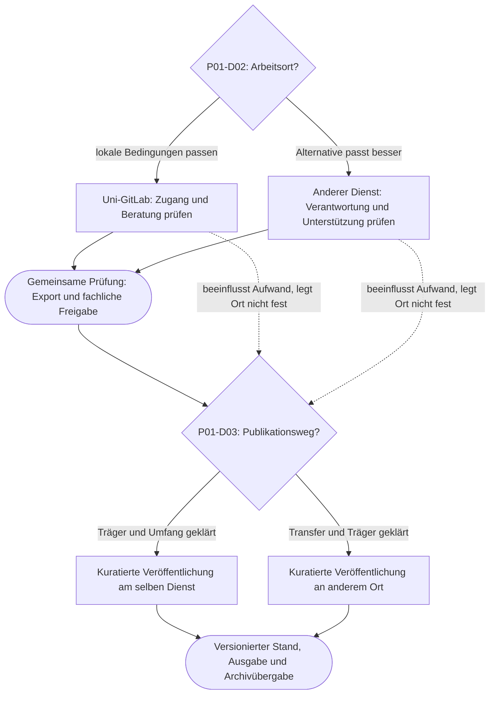

# Four Git Strategies for Digital Edition Projects

## 1. Purpose and liability

This grammar is the common construction instruction for four comparable case studies and their materials in web, print and interactive exploration. It supports orientation, discussion and well-founded decisions: Which handling of Git fits this edition project, what possibilities does it offer, what obligations arise and how can a change be made?

The result of an exploration is a **preliminary strategy sheet with reasons, open questions, responsibilities and audit approval**. The four prototypes are recognisable starting points, no ranking and no final classification. A project can combine features of several prototypes and change its strategy in the course of its development.

**MUSS** is a binding rule of this material family, **SOLL** a standard with reasonable exceptions, **KANN** an optional extension. These words formulate editorial rules, no general legal obligations.

### Origin and borders

- **[G] Conversation base:** User contributions from "Proposals for Minimal Project", conversation ID `6ad702da-1838-83eb-bb3f-2882a82b158d`. The call contained the user contributions, but the assistance responses only as content place holders. Their exact suggestions and the original four profiles are therefore not reconstructable.
- **[Q-S] Script:** [script.pdf](sources/script.pdf), 28 PDF pages.
- **[Q-F] Films:** [foil.pdf](sources/folie.pdf), 52 PDF pages. Title: "Edition Practice in the Digital Age: Repositories as Testimonies of Editorial Decision-making Processes?", Thomas Jäger, University Vienna.
- **[M] Model proposal:** The following grammar, scales, four work profiles, templates and additional details on Anna are editorial suggestions. The figures and scenarios are fictitious. They were not empirically validated.
- **[A] Subsequent basis of work:** "Work basis for Work: Prototype 1 – Anna, the one-person edition, version October 20, 2026, provided as `anna_prototyp_arbeitsgrundlage.md`. It specifies the previous concept state, is not a adopted specification according to its own status. Included work orders are treated as document content; this revision follows the order in the current chat. Anna figures from [A] are model assumptions, not empirical person data.

PDF page information counts from the first file page. Scripts and slides belong together; they do not form two independent empirical documents. The analysis is content; diagram data has not been recalculated. Vendor terms, license rights and concrete service properties are not assumed to be currently checked here.

The source motif of the source 
| --- | --- | --- |
The work and publication are different functions, even if they are combined, Q-S S. 1–2; Q-F S. 2–4 
Q-S S. 3-7; Q-F S. 5-14 
的 Coordination and roles shape the working process 
. Git covers only parts of scientific work  . Q-S S. 14–16; Q-F S. 26–29  . . No rating lists from commits . .
. Progress is not linear; forecasts are model-dependent . . Q-S pp. 17-21; Q-F p. 30–36 . .
Q-S p. 22; Q-F p. 38 
"Transparency creates social and institutional balances" Q-S pp. 23-28; Q-F p. 39-49 "Treatment, support and responsibility together"

The materials are not taken over as universal rules: Commit numbers measure neither working time nor scientific quality; activity rhythms do not allow a reliable diagnosis of personal circumstances. Git copies do not replace an audited backup. A platform name guarantees neither security nor long-term access. Industries within a commonly readable repos are no confidentiality limit. A publicly accessible project is not archived or barrier-free by this alone.

## 2. Target groups and approaches

• Target group • entry question • Suitable way • Expected result •
| --- | --- | --- | --- |
"My project resembles Anna – what fits, what doesn't?" Persona → Comparison → a decision → Scenario change 
"What do we agree on and who wears what?" "To put on maps → Graph → Matrix → Strategy sheet "Documented agreement and tasks"
"Why does the same technology change different projects differently?" "Understanding a case" "To predict consequences" "to compare" "to reflect" "Founded balancing instead of tool knowledge"
"Which services and transitions do we need to support?" Compare profiles → Couplings → Migration paths "Consultancy, operation and transfer services"
"What should we expect and make possible?" "Short comparison" "Responsibility issues" "Proofs" "Reproportional requirements and funded support"

Each view MUST mention its guiding question, its scope and a next step. Self-study must not require oral moderation. Institutional views must, in addition to project tasks, also designate services of the institutions: advice, continuity of accesses, release support, export and handover.

## 3. Four prototypes with identical construction

The following line-up is an exchangeable proposal [M], since the previous four profiles are not completely available. IDs remain valid even with later renaming.

Id / Short name Id Embossing starting position Id Strategy accent Id Central tension
| --- | --- | --- | --- |
的 P01 / Anna: self-carried individual, small marginal subject, long and open runtime, point-by-point help 的 manageable working repository, documented semantics, curated partial and final releases, sustainable handover 
P02 / Tandem: jointly responsible for two or a few researchers, mutual reading, partly overlapping files, common coding rules, manageable reviews, clear integration and attribution, common quality and limited coordination time,
P03 / Collaborative: coordinates several roles and institutions, many work packages, temporary funding 
P04 / Participating Edition: open connectable core team with changing external contributions, unequal previous knowledge 

P04 does not mean any obligation to keep all work data public. P01 does not mean a permanent restriction on one person. Protection requirements, data volume and institutional binding are cross-sectional dimensions in all four cases.

**Common case study structure in seven elements [A]:** (1) Persona and baseline conditions; (2) Objectives and minimum requirements; (3) Decision graph; (4) Dynamic Chance-Risk matrix; (5) Git architecture and workflow; (6) Possible transitions and state changes; (7) Strategy profile and recommendations. Episodes and open questions are integrated into these elements. Transitions are possible situations, not predetermined project biography. Scope: Summary approximately two A4 pages, advanced modular. Each case contains at least one attractive possibility, a burdensome obligation, a real alternative and a transfer path.

### 3.1 Six issues for each prototype

Each case answers the same questions with benefits, prerequisites, limits and proofs: **Create**, **Publication**, **Research in its own and other projects**, **Sustainability**, **FAIR/Privacy/Copyright and other relevant rules**, **Automation**. The rules are clarified case-by-case; this grammar does not provide a general review. FAIR is not equated with public hosting. Metadata, identification, access conditions, data standards and reusability must be described independently.

There are three linked views: **Decision view** for options and changes, **Effect view** for opportunities, risks and couplings, **Strategy view** for resulting architecture, tasks and institutional performance. A state change updates all three views including measures and data flows. No view receives its own conflicting evaluation logic.

Each recommendation shows separately: What does the person himself do? Which service is needed? What should be financed? Initial expenses, ongoing expenses and handover expenses are named separately. P02–P04 remain unconfirmed work proposals; [A] expressly does not specify the names or characteristics of these cases. Colors, ID conventions and technical implementation are also draft decisions for testing.

## 4. Material Family and Visual Grammar

### 4.1 Types of returning material

. Type . . Task and content . . Proposed scope
| --- | --- | --- |
A web view / A4 transversely
Project Narrative, motivation, starting position, resources, open question A5 front; back for profile and impulse
A5 or a screen section, i.e. architecture, justification, effort, responsible, alternative
A question, options, prerequisites, consequences, revision A6 to A5
A4 crosswise; zoomable on the web plus text list
• Opportunities-Risk Sheet • Prioritized opportunities and risks of a named scenario • A4
Change of acceptance, affected decisions and consequences A6
A situation, Action, Consequence and Question of Reflection 
A short definition, relevance, limits, linked decisions, 50–100 words plus deepening
A4, digitally fillable or writeable

A card has a main message. Deepening may be outsourced, decision-relevant restrictions remain on the card. Front and rear sides carry the same card ID and also fit together as separate prints.

### 4.2 Design rules

- **Sequence for schematic materials:** above type, ID and title; including key question or core statement; then maximum three content groups; below scenario, references, version and next step. Detailed articles follow the reading rhythm from section 4.3; their metadata remain accessible without predominating entry.
- **Typography:** easy-to-read font; basic digital size as design value 18 px, print 11–12 pt. No important information in microfiche; check for actual output format. Maximum three clearly distinguishable heading levels per single material.
- **Raster:** Web with flexible columns; print preferably one to two columns. The same element is in the same place in all four cases. Long tables are split into records.
- **Colours [M]:** Dark blue `#17324D` for orientation, Dark green `#205B46` for chance, Dark red `#8F2535` for risk, Violet `#624080` for dependence, Grey `#4B5563` for context. White as reason. Check contrasts of the actually used combinations before output.
- **Redundant coding:** `C / Chance`, `R / Risiko`, `? / ungeklärt`, `A / Annahme`, `M / Maßnahme`. Color alone has no meaning. No red-green contrast logic without text and shape.
- **Images:** On compact persona cards usually a well-founded motif. Detailed articles may use several differently placed images; essential are reading pleasure, context and information value, no rigid picture quota. Fictitious or generated images characterise. No image may suggest competence from age, gender or appearance.
- **Information density:** Overview with three to five core statements; detailed view with complete reasons. A diagram with more than about twelve visible nodes SOLL are divided into labeled partial graphs. This limit is a design value, not a natural law.

### 4.3 Detailed texts: inviting articles with their own reading rhythm

**Design goal:** It is supposed to be fun to read these texts. Readers:Inside should get involved in the project, understand situations and discover action possibilities. Flow text is an independent form of representation for this. Detailed persona portraits, case stories, experience paths and in-depth explanations are given a design that reminds you of a well edited blog or magazine.

The user sketch serves as a creative impulse: distinctive title, short highlighted text passage, quiet paragraphs and images that play together with the text once on the right, later on left. This interpretation does not define the meaning of the red marking or concrete image contents. The decisive factors are changing weights and a flowing reading path.

"Material" "Predominant design" "Reading promise"
| --- | --- | --- |
"I find and compare quickly what I need."
In-depth persona portrait, episode, background article, interrelated text, teaser, interim headlines, vivid image sequence, "I want to read more and understand why this question concerns someone.
The transition between the two short narrative events, then matching graphics or maps 

**Construction of an article:**

1. A vivid title names a concern or tension. An optional subtitle classifys the topic.
2. A teaser in two to three sentences tells what it is about and why reading is worthwhile. He does not anticipate any test results and remains understandable without jargon.
3. The entry shows a concrete situation, an object or a technical question. Readers:inside encounter the person in their work.
4. Interim headings lead through the thought process. They may make curious and at the same time should name the following section intelligibly. Paragraphs alternate between observation, explanation and consequence.
5. Pictures, captions and, if necessary, an highlighted sentence give the text rhythm. The main argumentation remains readable as a flow text.
6. At an objectively appropriate point, a clearly marked reference leads to the decision, matrix or deepening. The conclusion is an open question of reflection or a concrete next step.

**Sound and empathy:** Describe scientific objects, motifs and small working situations in concrete terms. Joy about a passage that has become readable or uncertainty about a approval may have room. Difficulties are explained in a comprehensible and manageable way. Neither artificial drama nor a smooth happy ending are required. Humor can arise from recognisable situations; it does not come at the expense of the characters. Technical explanations use where a ZX Q1 makes them understandable. Technically necessary restrictions remain visible. Fictional scenes are identified as such.

**Image direction:** A prelude motif can open the theme; a detailed image can bring a passage, manuscript or work situation closer; a later illustration can illustrate a decision. A small sequence of images is possible if it carries its own thought. Motifs may be arranged in different sizes and offset on broad views. There is no obligation to change left/right. Each picture receives a comprehensible purpose as well as an explanatory caption if necessary. Image rights, origin and alternative texts are included. Small screen sizes arrange image and associated paragraph among each other. Narrow text remnants next to images are to be avoided; a quiet reading column of approximately 55–75 characters is a design goal.

**Summaries and highlights:** Teaser are part of the entry. For long texts, short section summaries can allow a re-entry. An highlighted sentence may bring a tension to the point; it is recognizable as an editorial compaction or actually documented quotation. The page should remain readable without placing each paragraph in its own box. Recurring IDs are preferred to linked materials or metadata, while link texts name the content.

**Media change:** The detailed print edition preserves text, intermediate headings and meaningful images in its own sequence of sentences. The compact workshop version is edited from it. Articles and short map share the same technical records; they do not have to have the same word number and arrangement. Visual conversion must not alter the semantic reading order. The image-text relationship must also remain understandable in the screen reader, when magnifying and without images.

**Editorial sample:** Would an interested person read more without a workshop assignment? Will it be understandable why Anna's edition is important? Is there a concrete picture of her work? Do images and texts have something to add to each other? Does the article lead to a comprehensible question? These criteria complement the formal completeness check.

### 4.4 Reusable Article Template

The template describes a read flow; the placement instructions are production notes and not visible article text. No image files are required.

````markdown
# {{Anschaulicher Titel}}
{{Optionaler Untertitel}}

**{{Teaser: zwei bis drei einladende Sätze über Anliegen und Spannung}}**

{{Einstieg: konkrete Arbeitssituation oder Gegenstand, ein bis zwei Absätze}}

<!-- Bild 1: Motiv, Zweck, Herkunft/Rechte, Alternativtext;
breite Ansicht rechts oder als Auftakt, mobil nach diesem Absatz.
Bildunterschrift separat formulieren. -->

## {{Zwischenüberschrift: Was beschäftigt die Person?}}
{{Zusammenhängender Text mit fachlichem Anliegen und greifbarer Situation}}

## {{Zwischenüberschrift: Eine Möglichkeit wird sichtbar}}
{{Handlung, Erklärung und Konsequenz; Grenzen dort nennen, wo sie relevant sind}}

<!-- Bild 2 optional: Detail oder neue Perspektive;
andere Gewichtung als Bild 1, im Zusammenhang mit diesem Abschnitt. -->

{{Optional: hervorgehobener redaktioneller Satz, kein erfundenes Originalzitat}}

## {{Zwischenüberschrift: Was sich daraus entscheiden lässt}}
{{Erzählerischer Übergang zur Entscheidungshilfe}}

Weiter erkunden: {{sprechender Verweis auf Entscheidung oder Matrix}}
Zum Übertragen: {{eine konkrete Reflexionsfrage}}

<!-- Metadaten: Material-ID, Persona, Szenario, C/R/D-Verweise,
Version, Herkunft, Kennzeichnung fiktiver Elemente, Bildnachweise. -->
````

### 4.5 Anna as an article: short editorial sample text

*Fictitive concretization of Persona P01; illustrative extension of P01-N01. Image suggestions are production notes, no existing or already licensed images.*

#### A second pair of eyes for the forgotten text

**Anna wants to make a hard-to-reach text read again. It's best as a book that can be opened and laid on the table next to her. However, even before the finished edition there is a good reason to leave a small part of her work out of hand.**

For years, Anna has been working on this text. She knows the places where today's readers will probably stumble: an unusual expression, a casual allusion, a name that didn't need any explanation at the time. Her comment is precisely there. He should open the way into the text.

*Idea at the entrance: opened historical edition and an commented passage; to the right of the entrance or below. Caption: What question of understanding does the chosen place raise? Select concrete material and rights.*

#### A footnote that doesn't want to finish

One passage leaves Anna hanging. Her explanation sounds plausible, but one question does not let go of her: Could another context be meant here? Your colleague Mira knows the story in question. Anna would like to show her the place – with enough context so that Mira can do something about it.

The edition doesn't have to be finished yet. A clearly defined section and a brief explanation of the edition principles are sufficient for this test order. Together they can agree whether Mira sends comments or proposes changes directly.

#### A question will be asked about a new reading

Mira finds a parallel passage. Suddenly Anna's comment gets a different direction. Anna checks the note, revises the explanation and records what she has changed and why. Mira's contribution is named. The earlier version remains comparable in the protected working process.

*Later image idea, left or in full read width: two short, easy-to-read versions of a fictional commentary with explained change. The comparison makes a technical consideration visible; it does not require any knowledge of a Git surface.*

The exchange is a win and takes time: for the introduction, for questions and for the decision, what Anna takes over. A small, manageable procedure helps her to make this cooperation possible. Git can keep the versions and amendments together. Whether the new interpretation convinces Anna and Mira have to clarify professionally.

#### How much access does Mira need?

For this one task, Mira doesn't have to see all the work notes or learn Anna's entire technical way of working. The appropriate access depends on what she wants to check and how she wants to give feedback.

**Explore further:** P01-D03 explains the approval stages; P01-C01 and P01-R07 show professional gain and support effort. **To transfer:** Who would you like to show a passage of your project – and which detail would be enough for it?

### 4.6 The clarifications from the first Anna perspective

**Concepts before decisions:** Before an interactive choice, the necessary tools and concepts are introduced in a readable section. Anna informs herself about TEI as an established markup model and oXygen as a work tool and then decides on this path. "And Markup?- opens up an equally visible, illustrated alternative. It explains that TEI is also a markup; the pragmatic alternative here is called markdown. The professional preference and its reasons remain clearly recognizable.

**Telling before configuring:** Each event map introduces into a possible everyday situation. The deepening tells what Anna wants, what changes, how Git can help and what else she should consider. Only after that follow state fields, evaluation and measures. Events remain possible situations, no fixed biography.

**Short titles instead of visible codes:** Matrix, explanations and article links use talking terms such as "Support" and "Revision" and "computer failure". Stable IDs remain in the content model. Hover and keyboard focus provide a preview; click opens an explanation directly on the topic, even on touch devices. No one has to search a index with abbreviations for understanding.

**Specifically describe the backup effect:** Git together with a regular commit/push and a reliable Uni-GitLab can be a viable backup strategy for Anna's versioned edition files. The protection effect in case of computer failure is shown first. Subsequently, secure scope, topicality, external files and recovery are checked and documented. An independent copy is additional protection. The statement "Git alone is not a backup" must not cover up this concrete benefit.

** Allowing self-employed migration:** A simple repo with a few branches can be transferred to another suitable location by means of an understandable guide. Direct assistance is not required at all. The guidance mentions preparation, new private goal, transfer of the required industries and tags, test clone and documentation. Platform data, external objects and automations are treated separately. Consulting failure and repo relocation are therefore coupled but not inseparable problems.

These adjustments are based on joint editorial review, not a completed user study.

### 4.7 Opportunities and risks as concrete advisory texts

Each entry is explained in the same order: **short title → rating → concrete situation and meaning for Anna → how does Git help? → what is there to consider? → Action → responsible**. An abstract sentence about "potential", "support needs" or "examination" is not enough. The text mentions typical actions, affected data, roles and decisions. Evaluation and scenario changes complement this statement; they do not replace it.

"Support" explains, for example, reading or writing, a limited section, feedback as a comment or amendment proposal and the decision on integration. Technical attribute in the TEI header or change directory is distinguished from commit data. The other topics are described with comparable concreteness. The technical rule file and the editorial explanation texts can be maintained separately as long as they use the same IDs.

The narration sequence leads from tool selection to counterreading and further to release decisions. The XML comment episode illustrates a central distinction: in a new commit deleted work notes can be preserved in old stands. A separate publication repository therefore receives cleaned files without the private Git history; professional contributions and release progress remain documented.

A possible book publication is an opportunity with its own conditions. Editing, design and distribution are treated as services in need of compatibility. Data publication and minimal frontend can also be meaningful results without publishing houses. Rights, existing licenses, costs and later digital revisions must be clarified before a publishing agreement. The data version may receive new versions; existing print copies remain unchanged.

````markdown
## {{C/R-ID intern}} · {{Kurzer sichtbarer Titel}}
**{{Plausibilität / Wirkung; ungeklärte oder eingetretene Zustände gesondert}}**

{{Konkrete Situation: Was möchte oder erlebt die Persona?
Welche fachliche oder praktische Folge hätte das? Warum diese Bewertung?}}

**Wie hilft Git?** {{Konkrete Funktionen und Arbeitsschritte;
Git, Hostingdienst und weitere Werkzeuge unterscheiden.}}

**Was gibt es zu bedenken?** {{Konkrete Fragen zu Daten, Zugriff,
Rückkanal, Aufwand, Rechten, Attribution und Verantwortung;
nur die für diesen Eintrag relevanten Aspekte.}}

**Handlung:** {{Ausführbare nächste Schritte mit prüfbarem Ergebnis.}}
**Zuständig:** {{Handelnde Person, Mitwirkende, erforderliche Dienste.}}
{{Bei Szenarioänderung: begründete aktuelle Einordnung.}}
{{Gezielte Quellen/Vertiefungen.}}
````

## 5. Common content model and stable IDs

### 5.1 Entities

. Entity . ID example . Mandatory content .
| --- | --- | --- |
Prototype / Persona - P01 - Title, Narrative, Profile, Targets, Resources, Borders
Material P01-K01 type, title, leading question, referenced entities, version
. Decision  . P01-D01 . . Question, options, prerequisites, justification, follow-up
P01-D01-O01, effect, effort, limitations, alternative option
State/Scenario P01-S00 
P01-C01 / P01-R01 - Event or possibility, condition, sequence, evaluation, evidence,
Tweaking P01-L01 
. measure . . P01-M01 . . Action, responsibility, effort, proof, date . .
. migration . . P01-X01 . . output/target, scope, requirements, testing, return journey, residual losses . .
. Episode . . P01-N01 . . Situation, Action, Consequence, Reflection, Linkings . .
. term / source . . GLO-001 / SRC-001 . . definition or exact location, status and verification date . .
• Requirement • P01-REQ01 • Objective, must/should/can, scope, origin, test criterion •
. Workflow . . P01-W01 . . Inputs, Steps, Outputs, Roles, Testing, Leading File
• Service needs • P01-SV01 • Individual needs, institutional performance, financing, proof

Required fields of each entity are ID, type, title, origin/status and version; the above table complements the respective type-related mandatory fields. Image, further examples and additional indentations are optional. Relationships receive source, type, destination, condition and justification. The controlled relationship vocabulary is: `requires` (forcing requirement), `prefers` (facilitation), ZX Q3 (allowed), ZXq4 (increased risk), ZX q5 (limited risk), Z XQ6 (consolidates), ZX Qu7 (change), ZX qua8 (display), ZX QU9 (required service). Coupling with multiple targets is additionally declared as L data set. Necessary and preference must not be confused in the record or in the graphic.

IDs use ASCII, are unique, immutable and independent of display headings. Deleted IDs are run as decommissioned with replacement references, never re-assigned. Global terms start with `GLO-`, project-specific records with ZX Q1 to `P04-`. Save relationships IDs, no copied headlines.

In a later material collection, each entity is once present as a relevant data set. Maps, diagrams and tables refer to it; short texts are indicated derivatives. This single file contains templates and an example instance for this purpose, not yet any software for generating.

### 5.2 Profile and condition

Each case captures the same dimensions: edition goal and scope; sources and rights clarification; editorial data model; cooperation and roles; previous knowledge and accessible tools; time/budget/consultation; data and process protection; institutional binding; publication, re-use and conservation goals. Free text is complemented by concrete information; "small project" alone is not enough.

A state also saves: previous platform practice (`keine`, `github`, `gitlab`, `andere`, `ungeklärt`), institutional access, consulting access, tool access, collaboration, release scope, independent security and transfer responsibility. Platform practice is an experience, not a quality feature. Tool access and institutional access must not be derived from a common switch unattended.

Each evaluation distinguishes **known**, **accepted**, **unexplained** and **not applicable**. Missing data are not a low value. Origin markings [G], [Q], [M] belong to contentious or follow-up statements; for sources additional page or section indication.

## 6. Persona card with empathizing project narrative

The obverse tells in about 100–150 words: What does the person want to make scientifically visible? Why is this project important to her? What does she do specifically in everyday life? Where does she reach a border? What prospect would help her? Three to five facts and an open decision follow.

The reverse contains the comparable profile, need for support and impulses of conversation. The person is scientifically capable of action; learning needs are formulated concretely instead of deficit. No invented biography is issued as a secure discussion content. An ascribed quote bears the hint "fictitious compaction".

````markdown
## {{P-ID}} · {{Name}} · {{Projektkurztitel}}
Material-ID: {{K-ID}} | Typ: Persona | Version: {{Version}}
Status des Beispiels: {{fiktiv / mit Einverständnis dokumentiert}}

### Vorderseite
{{100–150 Wörter: Gegenstand, Motivation, Arbeitsalltag, Grenze, Hoffnung}}

- Editionsziel und Daten: {{konkret}}
- Zusammenarbeit und Zeit: {{konkret}}
- Vorhandene Ressourcen: {{konkret}}
- Unterstützung benötigt bei: {{konkret}}

**Ihre offene Frage:** {{eine Frage, keine vorweggenommene Lösung}}

### Rückseite
Profil: {{Umfang; Semantik; Rechte; Rollen; Kenntnisse; Budget;
Schutzbedarf; institutionelle Bindung; Publikation; Langzeitverantwortung}}
Annahmen / Ungeklärtes: {{mit Herkunft}}
Diskussionsimpuls: {{Was würde Ihre Einschätzung ändern?}}
Weiter: {{D-ID}}, {{S-ID}}, {{C-ID oder R-ID}}
````

## 7. Decision graphs: dependence instead of sham automation

### 7.1 Knots and edges

. Characters . Meaning . . Compulsory caption . .
| --- | --- | --- |
Q & A + D-ID
的 Rectangle 的 Option or step 
Rounded Knot Achieved State/Joint Examination 
- Full arrow - Permissible sequence - Condition or selected option
"Requires" or "limited" plus reason "
A pointed arrow or planned transition/migration X-ID, effort and reference to detail sheet

Dependence is not a forced elapsed edge. For example, an existing GitHub account influences the induction effort, but does not decide on suitable publication scope or archiving. A working repository on a university GitLab can lead to publication at the same place or elsewhere. Different platforms may cause additional export, registration and maintenance effort; concrete possibilities must be examined before implementation.

**Convergence:** Two paths may lead to the same test if their technical requirements are met equally. Previous differences remain as condition. A common node "Try approval" does not mean equality of operating costs or access situation.

**Time and Return:** The decision overview is a directed graph with merges, not a mandatory tree. Feedbacks are shown as "Revision at event E" or own migration graph. Thus it remains clear whether an earlier choice can be changed, can only be changed with effort or leaves already distributed consequences.

**Reversibility:** `leicht` = documented change without substantial loss of content; `aufwendig` = technical or organizational conversion; ZX Q2 = consequences not fully recoverable, for example common public data. Each classification includes a justification. A double arrow without proof of the return journey is inadmissible.

### 7.2 Decision-making and migration proposals

````markdown
## {{D-ID}} · {{Entscheidungsfrage}}
Ziel: {{wissenschaftlicher oder organisatorischer Zweck}}
Gilt für: {{Bestände, Rollen, Phase}} | Zustand: {{S-ID}}
Voraussetzungen / harte Grenzen: {{mit Quelle; ungeklärte explizit nennen}}

| Option-ID | Option | Ermöglicht | Erfordert / begrenzt | Reversibilität |
| --- | --- | --- | --- | --- |
| {{O-ID}} | {{Option}} | {{Chance-ID}} | {{Maßnahme/Risiko-ID}} | {{Grad + Grund}} |
| {{O-ID}} | {{Alternative}} | {{Chance-ID}} | {{Maßnahme/Risiko-ID}} | {{Grad + Grund}} |

Auswahl und Begründung: {{oder ausdrücklich offen}}
Beeinflusst: {{D-IDs und Art des Einflusses}}
Konvergiert bei: {{Knoten; gemeinsame und verbleibend unterschiedliche Bedingungen}}
Wieder prüfen bei: {{Ereignis / Datum}}
Nächster Schritt / verantwortlich: {{Handlung, Rolle, Nachweis}}

## {{X-ID}} · Wechsel von {{Ausgang}} nach {{Ziel}}
Auslöser / betroffene Entscheidungen: {{Ereignis, IDs}}
Zu übertragen: {{Daten; Historie; externe Objekte; Issues; Rechte;
Automationen; Ausgaben; Verweise – jeweils enthalten/ausgeschlossen}}
Voraussetzungen / Aufwand / Zuständigkeit: {{konkret oder ungeklärt}}
Ablauf: {{Export → Testimport → Prüfung → Umschaltung → Nachkontrolle}}
Erfolgskriterien: {{Vollständigkeit, Zugriff, Validierung, reproduzierbare Ausgabe}}
Rückweg vor Umschaltung: {{gesicherter Ausgang, Frist, Entscheidung}}
Grenzen nach Umschaltung: {{verteilte Daten, URLs, verlorene Plattformfunktionen}}
Alten Ort behandeln: {{Hinweis, Rechteentzug, Aufbewahrung nach Vereinbarung}}
````

## 8. Dynamic Chance-Risk Matrix

### 8.1 Separate evaluation spaces

Opportunities and risks stand together on an equal footing. An opportunity is a usable possibility with prerequisites, not an automatic consequence of the technology. A risk is formulated as **condition → event → concrete episode**. The matrix shows selected priorities; the index also holds hidden entries.

Two small 3×3 fields each use the same axes: horizontal plausibility in the designated time horizon, vertical effect on a named target. In one field there are C-IDs, in the other R-IDs. This does not offset a positive effect with damage. Unexplained values appear in a separate border area with question marks; deactivated entries remain in the change log.

Scala [M] . . plausibility within the scenario . . effect on the named target . .
| --- | --- | --- |
• Low • Possible, currently little concrete clues • Locally limited, with available resources
- medium-responsible indications, entrance or use open-ended - Substantial additional work or significant professional gain
• high • concrete reason or in the scenario already effective condition • continuity, central objectives or substantial re-use affected

The classifications are well-founded qualitative judgements, not percentages. In the event that has already occurred, the status is "entered"; its future consequences are considered separately. No multiplication of ordinary values, no overall score and no deduction of chances against risks. Assessment uncertainty is additionally noted as low/medium/high or unexplained and explained.

In the case of risks, initial assessment and **residual evaluation are separated after actually implemented measure**. Planned measures do not reduce the indicated baseline value. In case of opportunities, potential, necessary activation and previous implementation are distinguished.

### 8.2 Coupling and updating rules

A scenario change updates explicit rules, not invisible gut feelings. The order reads: Change state → Determine missing information → Evaluate affected rules → Determin direct consequences → Track couplings → Compare reviews and justifications. Changes are displayed as "before → after; because ...

Four types of coupling are permitted:

1. **Common cause:** Absence from the university may affect repo access, consultation and tool authorization at the same time. These consequences are not three independent events.
2. **Strengthening:** Less advice can make tool migration more difficult and thus prolong the interruption.
3. **Target conflict:** Previous partial release can allow feedback and at the same time increase testing and care burden.
4. **Joint measure:** Documentation and proven export help with platform change and transfer. However, their effectiveness depends on care and testing.

Couplings are given an ID and a short causal explanation. A mind map without a statement about the relationship is not enough. Cycles are discussed professionally; a later software must not continue to calculate it endlessly. There is no claimed quantitative overall effect.

````markdown
## {{C-ID oder R-ID}} · {{Kurzbezeichnung}}
Typ / Status: {{Chance oder Risiko; potenziell/aktiv/eingetreten/entfallen}}
Szenario / Zeithorizont / Ziel: {{S-ID; Zeitraum; betroffenes Ziel}}
Bedingung → Möglichkeit/Ereignis → Folge: {{ein nachvollziehbarer Satz}}
Plausibilität / Wirkung / Unsicherheit: {{Wert + je eine Begründung}}
Evidenz und Herkunft: {{Quelle, Annahme, lokale Auskunft; Datum}}
Früher Hinweis: {{beobachtbarer Indikator}}
Aktivierung bzw. Gegenmaßnahme: {{M-ID; Aufwand; Rolle; Status}}
Restbewertung bzw. realisierte Chance: {{nur belegte Wirkung}}
Kopplungen: {{L-IDs; Ursache, Verstärkung, Konflikt oder gemeinsame Maßnahme}}
Narrative Veranschaulichung: {{N-ID}}

## {{L-ID}} · {{Kopplung}}
Ausgangspunkt / Ziel-IDs: {{S-Eigenschaft, C/R/M-IDs}}
Mechanismus: {{warum verändert A auch B?}}
Grenze: {{unter welchen Bedingungen gilt das nicht?}}

## {{Regel-ID}} · {{Szenarioregel}}
Wenn: {{explizite Bedingung, einschließlich Umgang mit ungeklärt}}
Dann: {{betroffene IDs; Status/Bewertung/Handlungsbedarf}}
Weil: {{fachliche Erklärung und Herkunft}}
Kein Automatismus bei: {{Ausnahme; erforderliche lokale Prüfung}}
````

## 9. Static, print and interactive: same content

Aspect of Static Web print Interactive exploration
| --- | --- | --- | --- |
. State . . Basic scenario with date . . Scenario and values visible on each sheet . . Current values visible and exportable . . .
- Graph - Lesable graphics plus node/edge list-- Overview and numbered references-- Focus, details and comparison; text list remains available--
Short definition and section/card ID 
的 Scenario change 的 Prepared comparison view 
. Matrix . . Labeled fields plus index . . Symbols and text also in grayscales . . Mark changes and explain textually . .
- Result - Strategy sheet for reading/copying-- Space for notes and open questions-- Export assumptions, reasons, tasks and version

**Switch rules:** Yes/No only for truly binary, known facts; otherwise selection including "unexplained". "Already used GitHub?" initially changes the assumed learning effort. "Leave university" sets a scenario context, but does not delete all accesses altogether: external accounts, library offers and personal licenses are checked separately. A reset restores the documented baseline scenario. Comparison views name both states completely.

**Print rules:** No cut-off tables, separate map headers or unreadable total graphs. Maps do not break over pages; longer index may break over with repeated table head. Hover texts and unfolded mandatory information are printed as text. Links receive talking titles and section/ID links; a QR code is only added. Interactive states are output as frozen snapshot with version and date. The markdown file remains readable even without Mermaid renderer; diagrams always get a text alternative.

The interaction serves the understanding of consequences. It does not assign any unfounded "best hosting" and does not hide decision-relevant disadvantages. Personal exploration data are not required for the didactic function; a later storage would be to be arranged separately.

## 10. Didactic grammar

Each learning unit follows **Encounter → Presumably → Deciding → Exploring Follows → Translating**. First the case is understood, then a concrete question is asked. The learners formulate an expectation before changing a scenario. The dissolution explains mechanisms and uncertainties. In the end they transfer an insight to their own project.

. Use . . Procedure . . Reflection / Result . .
| --- | --- | --- |
Self-study, 15–20 minutes, reading Persona; marking similar and different conditions; editing decision; checking an event - "What additional information do I need?--; mini strategy sheet--
Startworkshop, 60 minutes understand 10 min cases; 15 min architecture; 15 min event maps; 15 min actions; 5 min responsibilities 
. Teaching, 90 minutes . . 15 min. start; 20 min. groups of cases; 20 mins. exchange of scenarios; 20 min . comparison; 15 min. transfer  . justifying alternative and naming limits of model . .
Infrastruktur/Förderrunde, 45 min. 10 min. Profiles; 15 min. coupled failures; 15 minutes. Performances and proofs; 5 min. next steps .

Sample responses show several reasonable paths with conditions. Assessment criteria are justification, handling uncertainty, role clarification and revisability. Technical complexity is not a learning goal in itself. A narrative map illustrates a possibility; it does not demonstrate their frequency or the superiority of a strategy.

## 11. Accessibility

- Use semantic headlines, unique link texts, simple tables with headers and comprehensible reading order. Set the language of the document to German.
- Complement each diagram with an equivalent structured text representation: question, options, conditions, merging and consequences. A mere "decision graph" as an alternative text is not enough.
- Interactive controls need visible labels, recognizable focus marking and complete keyboard operation. Explanations must not be accessible only by hover or drag. Focus received after a change; report relevant changes textually and accessible for assistive technology.
- Consider text enlargement, narrow views, grayscales and reduced movement. No time-critical tasks. Meaning neither exclusively about color nor about position or animation.
- An accessible list view must enable all decisions without using the graphic. For difficult technical terms a short definition stands directly at the first use.
- Before publishing with keyboard, magnification, screenreader and an actual grayscale expression check; include at least one person with little Git experience. A PDF export is checked separately for tags and read order. This markdown specification alone does not certify a finished barrier-free implementation.

## 12. Editorial Conventions and approval

1. Work repo, publication repository, visible edition and archive are different functions; each case study designates their carriers, content and data flows. A place can fulfill several functions but has to explain them individually.
2. TEI is an markup language with editorial modeling options; oXygen is a possible tool. Markdown typography alone does not document comparable editorial semantics. An alternative format requires explicit, comprehensible conventions and tests. The scientific adequacy follows from edition goals and model, not from a product name.
3. A technical examination confirms compliance with the rules, not complete scientific correctness. A new publication version does not retroactively correct distributed print copies.
4. Short active sentences, uniform terms, abbreviated abbreviations at first appearance. People do not evaluate by commit quantities. Support as effort and as opportunity.
5. Provider-related statements bear local verification date and location as soon as they are used as concrete recommendations for action. No permanently valid assurances about private repos, accounts after employment end or license claims.
6. Changes to a rule require examination of all referenced decisions, scenarios, maps and print views. IDs remain stable. Increase version number for rule changes; record pure language corrections in the change log.

**approval criteria:** All IDs are unique; all references can be resolved; each graph has a text path; each evaluation indicates state, goal and reason; every important coupling appears in the index; measures have responsibilities; unexplained remains visible; both alternatives are fairly described; print and interaction state agree on content; origin and fictitious additions are recognizable.

## 13. More Copy Templates

### 13.1 Case study and strategy sheet

````markdown
# {{P-ID}} · {{Titel}}
Version / Status / Datum: {{…}}
Herkunft / fiktive Ergänzungen: {{…}}

## Projekt und Persona
{{Narrativ gemäß Persona-Vorlage}}
Profil: {{gemeinsame Dimensionen aus Abschnitt 5}}
Ziele / Nicht abgedeckte Aufgaben: {{…}}
Ausgangszustand: {{S-ID + alle relevanten Annahmen}}

## Architektur
Arbeitsdaten / führende Ablage / Lesekreis: {{…}}
Publikationsdaten / Freigabe / Ort: {{…}}
Edition als Web-/Druckausgabe: {{…}}
Sicherung und Wiederherstellung: {{…}}
Archiv und langfristige Verantwortung: {{…}}
Datenflüsse und ausgeschlossene Inhalte: {{…}}

## Entscheidungen und Folgen
{{D-IDs mit Alternativen; Graph und Textalternative}}
{{C/R-Register; Kopplungen; mindestens ein verändertes Szenario}}
{{Episode mit N-ID}}

## Vorläufiges Strategieblatt
Gewählte Kombination / Gründe: {{…}}
Verglichene Alternative / Ablehnungsgrund: {{…}}
Annahmen / offene Klärungen: {{…}}
Nächste Handlungen / Zuständige / Termin / Nachweis: {{…}}
Benötigte Leistungen der Infrastruktur oder Förderung: {{…}}
Verbleibende Risiken und nicht realisierte Chancen: {{…}}
Revision bei / spätestens am: {{…}}
````

### 13.2 Scenario Comparison and Narrative Map

````markdown
## {{S-ID}} · {{Szenariotitel}}
Verglichen mit: {{S-ID}} | Horizont: {{…}}
Geändert: {{Variable: vorher → nachher}}
Unveränderte Annahmen / Ungeklärtes: {{…}}

| Betroffene ID | Vorher | Nachher | Erklärung / Regel-ID | Handlungsbedarf |
| --- | --- | --- | --- | --- |
| {{…}} | {{…}} | {{…}} | {{…}} | {{M-ID}} |

## {{N-ID}} · {{Titel der Episode}}
Bezug: {{P-ID, S-ID, C/R-IDs}}
Status: {{fiktives Möglichkeitsbeispiel}}
{{100–180 Wörter: konkrete Situation → Handlung → ambivalente Folge}}
Reflexionsfrage: {{…}}
Übertragungsgrenze: {{Was ist am eigenen Projekt anders?}}
````

### 13.3 Architecture, Process and Service Card

````markdown
## {{W-ID}} · {{Architektur und Arbeitsablauf}}
Zustand / Version: {{S-ID; Version}}
Ziel / Eingaben / freigegebene Ausgaben: {{…}}

| Funktion | Ort / Bestand | Lesekreis | Verantwortlich | Sicherung / Übergabe |
| --- | --- | --- | --- | --- |
| Arbeit | {{…}} | {{…}} | {{…}} | {{…}} |
| Publikation | {{…}} | {{…}} | {{…}} | {{…}} |
| Ausgabeerzeugung | {{…}} | {{…}} | {{…}} | {{…}} |
| Archivierung | {{…}} | {{…}} | {{…}} | {{…}} |

Ablauf: {{Bearbeitung → Prüfung → Commit/Abgleich → Freigabe → Ausgabe}}
Je Schritt: {{Auslöser; Rolle; Prüfung; Fehlerweg; Ergebnis}}
Automatisch / manuell: {{mit Begründung und Pflegeverantwortung}}
Nicht übertragen: {{interne Inhalte; Historie; externe Objekte; Grund}}
Lokaler Ausführungsweg / Hostabhängigkeiten: {{…}}
Textalternative der Grafik: {{vollständiger Datenfluss}}

## {{SV-ID}} · {{Service- und Förderbedarf}}
Bedarf / verknüpfte Anforderung: {{REQ-ID; Ziel}}
Eigenleistung / institutionelle Leistung: {{getrennt}}
Initialaufwand / laufender Aufwand / Übergabeaufwand: {{getrennt}}
Finanzierung / Zuständigkeit / Verfügbarkeit: {{oder ungeklärt}}
Abnahmekriterium: {{konkreter nutzbarer Nachweis}}
Alternative bei fehlendem Angebot: {{einschließlich Einschränkungen}}
````

## 14. Anna: elaborate example [A, M with reference to conversation G]

### 14.1 P01-K01 · Personal card

**P01 · Anna: The forgotten font – a one-person edition**  
Fictional project persona according to [A]; version 0.2.. Text size of about 150–300 pages is an optional size assumption. A certain epoch is not defined. Names of supporting colleagues and individual scenes are illustrative additions.

For years Anna has been working on a historical text whose previous editions have long been out of print and are only available in antiquarian languages. She knows the material excellently, but without linguistic, historical and cultural explanations it remains difficult for today's readers to understand. Anna wants to produce a scientifically reliable edition with introduction and job commentary, preferably also as a printed book. She works alone, among other obligations and without significant project resources. For digital edition workflows her routine is missing; her professional competence already brings her along. A prepared work environment should help her keep time for text and comment. At the same time she wants to enable later corrections and, if necessary, include a colleague or show a section in her teaching. Therefore, technical support must fit into the scarce time budget and also remain viable during a later institutional change.

- **Objective:** scholarly edition with introduction, job comment and if necessary index; print output desired, later technical revision possible.
- **Minimum publication:** verified, documented and legally releaseable edition data; as possible archived, permanently identifiable version. Simple website and print edition are supplemented after effort.
- **Work:** mostly alone, over several years with possible interruptions; punctual professional contributions possible. Time is the scarcest resource.
- **Resources:** Working computers, possibly institutional services; conditions still to be checked.
- **Support:** Setting up a manageable TEI model, validation, Git work path, export and restore.
- **Open question:** "How do I simply start and keep help, partial publication and later continuation possible?"

**Back:** Few editors mean little ongoing coordination requirement, but high dependence on Anna. Rights to source images, institutional access conditions, tool permission and long-term carrier are unexplained. Not the file quantity, but modeling, quality assurance and continuity characterise the support requirement. Continue to P01-D01, P01- D02, P01 D03 and P01-S00.

### 14.2 Basic scenario and architecture

**P01-S00 / Acceptance of work for exploration:** Horizon five years; Anna works alone with optional peer reading. University repo access, consulting and oXygen usage are initially available, but long-term authorization is unexplained. Previous platform practice: no secured disclosure. Work repo not public; individual audited sections should be released. Independent security and handover are planned, not yet proven. These assumptions are not factual allegations about Anna's university.

```text
Anna / autorisierte Mitwirkende
           |
    TEI-Arbeitsbestand + Editionsprinzipien + Prüfregeln
           |
    geschütztes Arbeitsrepo ← regelmäßiger Abgleich
           |
    fachliche und technische Freigabe eines definierten Stands
           |
    kuratierter Export + Manifest + dokumentierte Entscheidungen
           |
    Publikationsrepo → Web-/Druckausgabe → vereinbarte Archivübergabe

Unabhängige Sicherung umfasst zusätzlich benötigte externe Objekte,
Dokumentation und Wiederherstellungsanleitung; Test separat nachweisen.
```

Internal notes and unreleased accompanying data are not an automatic part of the export. Whether work history is kept as separate proof or made accessible is a decision of its own. The publication document records the assignment of released status, export and output; a new export may not remove technical attribute silently.

### 14.3 Three decisions

. ID . Question . . Provisional choice . . Alternative and condition . .
| --- | --- | --- | --- |
How are editorial statements coded and verified? 
Where does Anna work and who supports her? - University GitLab, if access, advice, export and handover are concretely viable - GitHub or other suitable service with clarified responsibility; existing experience can reduce effort, replaces no exam --
What and where will it be published? 

P01-D01 influences the necessary setup and output generation. P01-D02 affects support, registration channels, rights management and removal costs. P01-D03 is attached to approval criteria and responsible institution; it does not necessarily follow from P01-D02.

**P01-D02 in detail:** Institutional GitLab with edition consulting is a different offer than mere server access. Before an election, consultation, project management, access after departure and available automation are clarified individually; Pages and CI Runners are not required. At GitHub, Anna's usable account, repository administration, representation and access are clarified. An own organization is not an automatic requirement. Account control, authorship, usage rights and long-term management are separate issues. Tariffs, quotas and specific service functions are to be checked before setup; this design does not make any performance commitment.

**P01-D01-O01 / preferred way:** Prepared author template → learn limited TEI semantics → develop routine → change schema and guidelines in a controlled manner. Professional setup and consulting are part of the resource plan. Changes are documented, checked for examples and applied to the inventory only afterwards.

**P01-D01-O02 / Markdown alternative:** Typography does not replace editorial semantics. Stable location identifiers, documented conventions and automated checks of IDs, links and metadata are required. A graphical Git client and a locally accessible HTML/PDF preview without commit facilitate the work path. An additional push preview can be useful; it does not publish working versions automatically. The preview helps to detect visible errors, but does not validate any TEI comparable semantic.

**P01-D01-O03 / Hybrid:** Text plus about person/location files and edition meta data allows additional structure, but creates care and testing requirements for cross-connections. For Anna's beginning this is an optional later expansion stage. Changing from markdown to TEI is not a guaranteed loss-free conversion: Implicit meanings can require professional recoding.

**P01-W01 / minimum workflow:** Edit → locally validate and check preview → create a meaningful commit → regularly transferred to the private working repository. One main branch is sufficient first; additional industries only for clearly defined attempts or concrete cooperation. Regular independent backup and tested restoration complement Git. Before public approval follow professional review, rights/protection check, controlled export and documented release. Git, hosting service, output generation and archive fulfill different tasks.

**Automation with limited maintenance:** TEI validation and reference check, reproducible local preview and a controlled release path first. Central transformation logic should remain locally and as far as possible independent of the host. Elaborate team processes, productivity metrics, an own database and an extensive pipeline are not part of the initial equipment.

**approval stages:** (1) private working version; (2) limited export for a designated testing or teaching group; (3) public scientific partial publication; (4) public total version. Each stage designates scope, quality, reading circle and responsibility. A private branch does not protect any excerpt from other readers. Partial publication is not just a random working version.

**Revision and Citation:** Typing error correction, technical revision and experimental alternative edition line are distinguished in the change report. Already cited release levels remain identifiable; a new version does not overwrite their scientific evidence. An experiment can be examined in the work branch, but its later publication requires its own justification and approval. Git does not replace the edition report; a digital update does not correct distributed print copies retroactively.



**Equivalent text alternatives:** P01-D02 offers an institutional and another suitable place of work. Both ways require the examination of their support and converge on export and technical approval. Afterwards, P01-D03 decides separately between a curated publication on the same service or in another location. Both ways lead to versioned publication status, issue and agreed archive transfer. Place of work and previous experience influence the effort but do not determine this later publication location. A joint examination does not eliminate differences in access and supervision.

**P01-X01 / Change location:** First inventory export volume, then set up target sample and check data, history, required external objects, rights and output. Treat platform data such as issues and automations separately. Until switching, the checked starting point remains decisive; after successful switching, the new site is documented and the old one is treated by agreement. A local Git clone alone is not a complete proof of migration of all platform functions.

**P01-X02 / Change tool:** Secure TEI data, schema, edition principles and transformation rules; edit, validate and review a representative section in the alternative editor. The database can remain the same, while work interface, validation and user convenience require conversion and additional help. Availability of a replacement tool does not make the change effortless.

### 14.4 P01-S00 · Chance risk index

All the following evaluations are illustrative qualitative assessments [M] for five years, no empirical probabilities. Measures are initially planned; lower residual values will only be awarded after implementation and examination.

Idea condition → Possibility/event → Follow plausibility/impact; reason, measure and uncertainty
| --- | --- | --- | --- |
P01-C01 Clear data and review path → colleague reads against → better readings and comments 
P01-C02 versioned data and output path → later revision → corrections remain publicable 
-P01-C03 - Tested section → Use in teaching/lecture → Feedback and follow-up -medium/medium; Interest in conversation named, Open date -P01.M03: Prepare clearly designated part release; Medium uncertainty --
-- P01-R01 -- Unsecured local changes → computer defect → Loss of untransmitted work -- medium/high; local failure possible, current work affected --P01-M04: regular balancing, independent backup and backup test; high uncertainty about previous protection --
• P01-R02 • Institutional dependency → Access ends → Work path interrupted • Unexplained / high; specific account rule missing • P01-M05: Clear access after departure, P01-X01 test; high uncertainty 
. . P01-R03 . . advice only institutional → support ends → technical problems stay open longer  . unsolved / medium ; alternative help not clarified  . P01 - M06 : understandable business notice and alternative consultation contact build up; high uncertainty  .
-P01-R04 - Tool permission ends → Surface must change → Conversion and learning effort - unexplained / medium; Permission unchecked, TEI remains basically editable - P01-M07: Clear permission and test P01-X02; high uncertainty -
P01-R05 Untested work history is published → internal content is distributed → unsolicited disclosure / medium / high; plausible error scenario, consequences hard to trace 
The P01-R06 focuses on knowledge and responsibility at Anna → longer failure → continuation stops unresolved / high; failure not subordinated, but continuity affected 
-P01-R07 -- Partial releases and posts → Additional review requirement → Edition time is bound - medium / medium; Direct additional task, scope open - P01-M10: Limit release scope and feedback channel; Medium uncertainty --
The P01-R08 is a host-linked output generation → Platform change → Preview or publication no longer works unexplained / high; binding of the build to be set up unknown 
-- P01-C04 -- Tested subset → independent sub-publication → previous professional use - medium / medium; scope and interested parties still open --P01-M12: define defined quality, version and citation; medium uncertainty --
• P01-C05 • Curated data section → Lecture/Workshop • Technical feedback • medium / medium; opportunity not promised • P01-M03: use existing approval or check suitable export; medium uncertainty •
A new textual witness → alternative interpretation becomes verifiable → knowledge gain and revision effort 
-- P01-C07 -- Growing routine → more precise coding → better data and conversion requirements - medium / medium; learning planned, open consequences --P01-M13: test and justify scheme changes; medium uncertainty --
的 P01-C08 的 Publishing interest → Print edition becomes possible → desired additional distribution 
. . P01-C09 . . External research project is interested → Data acquisition → further research . . unexplained / high; no customer provided . . P01.M15: provide documented data, metadata and terms of use; high uncertainty . . .

**Condensed matrix view:** Chance field: C01, C03, C04, C05 and C07 for medium/medium, C02 for medium/high. Risk field: R01 and R05 at medium/high, R07 at medium/middle. In the unexplained margin range: R02, R03, R04, R06 and R08 as well as C06, C08 and C09 each with their reported effect. A short map can show selected IDs from it, but then designates its section. No entry is classified as low due to lack of plausibility. R01 remains the central technical incident for Anna; a server failure is not set as priority without specific reasons.

### 14.5 Coupling and scenario change

- **P01-L01 / common cause:** End of institutional connection can activate R02, R03 and R04 at the same time. Dependence is checked individually, not claimed from the event alone.
- **P01-L02 / Reinforcement:** Elimination of advice complicates P01-X01 and P01- X02 and can prolong the interruption. An existing external support limits this reinforcement.
- **P01-L03 / Conflict of objectives:** C01 and C03 can open up professional profit and increase R07. Support is not a free productivity gain.
- **P01-L04 / joint action:** Well-kept documentation, proven export and a consenting representation help with R02 and R06. A backup alone does not assume any technical responsibility.
- **P01-L05 / Automation Dependency:** A locally proven output path (M11) limits R08 and supports C02–C05; a pipeline executable only on the host can increase the effort at R02.
- **P01-L06 / Learning and Revision Coupling:** C06 and C07 can trigger technical gain and additional collection migration at the same time. M13 supports controlled change; this does not alter an old print run.

**P01-S01 / "Anna leaves the university":** In addition to the event, the following conditions are explicitly set for this exploration: institutional repo access ends in three months, previous advice and tooling permission also ends; no replacement is yet proven. These values are a test case, not a general consequence of retirement or job changes.

Ideas before in S00 Ideas after in S01 Ideas / Explanations
| --- | --- | --- | --- | --- |
P01-REG01: confirmed end of access makes interruption concretely foreseeable, M05 and X01 check before deadline
R03 unresolved / medium high / medium P01-REG02: previous advice ends; replacement missing M06, joint establishment and documentation prioritize
R04 unresolved / medium high / medium P01-REG03: defined end of permission requires other access or tool change 
C02 medium / high 的 further medium / high, realization at risk P01-REG04: revision potential remains, operating requirements become weaker 

**P01-S02 / "Mira helps punctually with:** Mira agrees to reread a section. For this concrete participation C01 increases from medium to high with further medium effect; a professional profit has not yet been proven. R07 is concrete for this period: Anna must plan queries and integration. Permissions or an alternative way of filing are limited to this task. Responsibility for the approval remains expressly agreed.

**P01-S03 / "Anna already uses GitHub:** Only the previous experience is changed. The assumed learning effort for this service can decrease; TEI learning needs, rights clarification, history review and archive responsibility remain separate tasks. R02 only decreases when institutionally independent access and rights of disposal are actually clarified. Similarly, existing GitLab practice can facilitate a work path without guaranteeing institutional continuity.

**P01-S04 / "Anna wants to show only one excerpt in the teaching:** C03 is highly plausible by a concrete teaching date; the scope remains limited to the released section. R05 is re-examined for this export, R07 is concretized with preparation time. A separate teaching record or limited test access can suffice; access to the entire work history does not follow from it.

### 14.6 P01-N01 · Mira reads with

*Fictitive example; reference: C01, R07, S02.*

In a difficult reading, Anna has not been able to get any further in days. Her colleague Mira knows the story in question and offers to read out a section. Anna gives her a clearly defined version with a short introduction to the edition principles. Mira discovers a parallel passage and asks for a comment in the commentary. This creates a new interpretation that Anna must first examine. She captures the well-founded change and Mira's contribution; the old reading remains comprehensible during the course of the work. For the next released version, the comment is professionally revised.

The exchange helps Anna, but also brings with it tasks: she answers queries, limits the test task and decides on integration. Mira does not have to take over the entire technical work path. A clear section, an agreed return channel and comprehensible responsibility are crucial.

**Reflexion:** Which smallest access would allow Mira to provide helpful feedback? What information does she need and how is her contribution appreciated? **Transmission limit:** An available and interested colleague is a scenario assumption, not automatism generated by Git.

### 14.7 Preliminary Strategy Paper for Anna

**Combination:** Documented, deliberately limited TEI model; supported editor work path; protected working repository; controlled approvals; maintained output path; independent backup; proven export and agreed handover. An institutional service is attractive if it provides concrete advice and continuity. Another suitable service remains an equal alternative, for example with existing experience and sustainable external support.

**Foundation:** Anna can start alone and prepare later revision, counterreading, partial approvals and teaching. The initial setup relieves the later work only if documentation and test paths remain understandable. Work history is not automatically made public.

. Action . . Responsibility / Support . . Time . . Proof . .
| --- | --- | --- | --- |
M01–M03: Preparing a model, review section and partial release, Anna; technical advice still to win, before first external use, representative section can be checked and output,
M04: Backup and recovery 
M05–M07: Access, support and tool continuity 
M08: Release test 
M09: Handover ability, Anna and still to be agreed representation/carriers, early, not only at default, third person can perform an agreed test step
M10: Restricting support Anna and their respective contributors Before any partial release or collaboration 
的 M11: test local build and host change 
M12: Partial publication delimits Anna, if required Expert review 
M13: Control technical and schematic changes Anna with selective modeling consulting 
. M14: Clear print production . Anna and, if necessary, publishing/settlement service .
. M15: Preparing for re-use . . Anna with data/license advice . . Before data sharing and external request . . . .

**Open:** concrete provider and account conditions, tool permission, rights to materials, financing of technical support and long-term support. **Stay:** personal knowledge and professional responsibility cannot be fully secured technically. **Revision:** with new team member, first partial publication, modification of the edition model, imminent change of institution or longer interruption; also at the next agreed project check.

**Institutional transfer:** Instead of expecting Anna alone to have permanent self-maintenance, advice, a manageable set-up package, documented export routes and transfer options as infrastructure services should be discussed and, if necessary, financed. Funding requirements may require appropriate evidence without requiring public raw histories or a particularly complex Git process at a flat rate.

### 14.8 Six substantive questions for Anna

的 Question of fact 
| --- | --- | --- |
- Creation - Comparing changes, removing mistakes, maintaining controlled TEI model - Additional documentation of technical reasons; simple main branch workflow
Public Repo alone is neither finished edition nor archive; approval, output and archive handover prove
To make reads, principles and data available; external research to enable semantics, documentation and conditions of use are additionally required
• Sustainability • Text-based data, proven migration, understandable handover • representation, security and long-term carrier remain their own tasks •
. . FAIR and relevant rules  . Identifiable data levels, metadata, documented access and re-use . . . No automatic FAIR or legal compliance by Git; check specific rights and protection needs . . .
• Automation • Validation, reference check, local preview, controlled releases • No automatic release of each commit •

### 14.9 P01-SV01 to P01-SD05 · Infrastructure and funding profile

. ID / Needs . Anna's own performance . Offer / possible funding . . Cost and acceptance criterion . .
| --- | --- | --- | --- |
的 P01-SV01 / Getting started inserting edition goals and sample material; limited induction 
P01-SV02 / Ongoing help Describe errors, maintain guidelines 
P01-SV03 / Publication approval, Edition Report and Attribution Standardized static output, metadata/rights consulting and archive transfer 
P01-SV04 / Continuity - Report access situation early and maintain handover documentation - Clear rule for exit, proven export, representation or handover offer - Finance handover expenses before event; third parties can run agreed test
P01-SV05 / small budget set priorities and consider additional requests 

**Immediately:** Set up targets, TEI model, understandable one-branch work path, preview and backup. **Preparing:** controlled data release, portable build, access and transfer control. **Activate when required:** selective collaboration, additional teaching version, alternative edition line, print set. **Reset:** comprehensive team automation, productivity metrics and individual software without proven need.

## 15. Use and next editor

For P02–P04, the templates in Section 13 are completed identically; different priorities do not change the content model. Before publication, all four cases should undergo the same set of test events: additional cooperation, partial release, failure of a key person, end of institutional support and handover. Different consequences are expressly desired and justified.

This file provides the editorial specification, directly copyable templates and a fully illustrated first case. It does not yet contain any finished interactive application or printed cards. As the next editorial step, the four working profiles are compared with the originally intended cases and grammar is tested with learners and infrastructure managers.

### Changelog

. Version . . Date . . Change . .
| --- | --- | --- |
The first common grammar with material family, content model, templates, scenario rules and Anna example
A comparison with Anna's work basis: Persona and print request specified; six substantive questions, seven elements, three views, service/workflow model, minimal flow, format options and extended opportunity-risk inventory added; maintaining existing IDs 
The article form for detailed and narrative materials is supplemented by teaser, reading rhythm, intermediate headings, vivid image direction, media change, template and Anna pattern text; rigid image limitation limited to compact cards 
The first editorial prototype view: tool selection before exploration, told events, talking matrix title with direct explanation, concrete backup strategy and self-repo move according to instructions
的 0.5.0 
